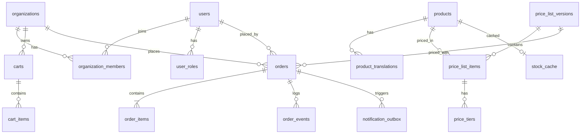

# iOrder.uz — Logical Data Model (Draft v0.1)

Date: 2026-10-17
Status: Proposal, technology-independent. Types are logical (`money` = fixed-point decimal, never float; `ts` = timestamp stored in UTC). The database and ORM are not chosen yet. Tags: [C] confirmed in discovery/lifecycle docs, [P] proposal, [A] assumption.

## 1. Modelling decisions

1. **Organization = Telegram group** [C]. For now a person belongs to one organization [C]. A separate membership table is kept so several organizations per person can be allowed later without redesign.
2. **Staff and customers are both `users`**, identified by Telegram user ID [P]. Staff roles are separate from customer membership roles.
3. **Prices live in versioned price lists.** An order points to the price list version it was priced with and stores a snapshot of every line [C].
4. **Stock is not owned by iOrder.** The Google Sheet is the source; iOrder keeps a read-only cache and only HOLDS quantity for approved orders (`order_allocations`), never subtracts [C, 2026-10-30].
5. **Order history is an append-only event log.** The current state on `orders` is a denormalized copy of the latest event [P].
6. **Notifications use an outbox table** written in the same transaction as the state change, so a status change and its message can never be out of sync [P].
7. **Discounts are not in the MVP** [P], but pricing resolves through one place (`price_list_items` + optional `price_tiers`) so organization discounts can be added later without redesign.
## 2. Entity overview

## 3. Tables

### Identity and organizations

**organizations**
| Field | Type | Notes |
|---|---|---|
| id | id | |
| name | text | shop / distributor name |
| type | enum | `GROUP` (a Telegram group; every organization before 2026-11-11) or `PERSON` (one individual in a private chat with the bot) [C, owner 2026-11-11]. Required when staff create one; the bot creates only `GROUP`. Manager and admin change it [C, owner 2026-11-12] (`PATCH /staff/organizations/:id`, audited), but only on an organization that was never bound [P]: no Telegram chat, no member history (a PERSON whose person left keeps its orders and debt, which a group bound later would inherit) and not merged; any other keeps its type (409 `ORGANIZATION_ALREADY_LINKED`; trigger `organizations_type_frozen_guard` refuses it in the database too). The open invite stays and its link follows the new type; a link sent in the old form is refused by the bot on use (wrong chat) |
| label | enum | `STANDARD` (default) / `WHOLESALE` (RU «Оптовик») / `PARTNER` (RU «Партнер») [C, owner 2026-11-11] / `ALIF_FACTORING` («Alif factoring», RU «Алиф факторинг») [C, owner 2026-11-12]; manager and admin set it at creation (optional); changing it later is the ADMIN's alone [C, owner 2026-11-12] (`PATCH /staff/organizations/:id`, audited; a manager's PATCH with a different label is 403, permission `CHANGE_ORGANIZATION_LABEL`; the manager's other fields are unchanged). It decides the price tier, see "Organization type, label and price tier" below |
| phone | text, null | the contact phone staff typed (`+<digits>`, CHECK); staff-only |
| telegram_chat_id | bigint, null | unique; the group (negative id), or for a bound PERSON the person's private chat (= their positive Telegram user id); CHECK `organizations_chat_matches_type` (NOT VALID: new and changed rows). NULL only while a staff-created organization waits for its invite; CHECK `organizations_chatless_is_inactive`: such a row is always `INACTIVE` |
| created_by_user_id | uuid, null | the staff member who created it in the staff app (no FK, like `published_by`); NULL for a group the bot registered |
| merged_into_organization_id | uuid, null | set on a group the bot registered a moment before the same group's invite link bound it to a staff-created organization (that one takes the chat; this row keeps its history, has no chat and is never listed or counted) [P] |
| status | enum | `ACTIVE`, `INACTIVE` |
| price_posting_enabled | bool | receives the daily price post [P] |
| telegram_status_event_at | ts, null | Telegram time of the last group event that changed the status; an older (retried, reordered) event is ignored |
| archived_at | ts, null | [C, owner 2026-11-13] set when the admin "deletes" (archives) the organization; NULL = not archived. See "Archiving an organization" below |
| archived_by_user_id | uuid, null | FK users (Restrict): the admin who archived it. CHECK `organizations_archived_pair`: both set or both NULL; CHECK `organizations_archived_is_inactive`: an archived row is always `INACTIVE` (migration `organization_archive`) |
| created_at, updated_at | ts | |

**Archiving an organization [C, owner 2026-11-13]:** staff may "delete" an organization, but deleting is ARCHIVING only, never a hard delete: orders, payments, member history and notifications reference the organization (ON DELETE RESTRICT) and history is never deleted (hard rule 12). Only the ADMIN archives and restores (permission `ARCHIVE_ORGANIZATION`; `POST /staff/organizations/:id/archive` and `/restore`, both answer the organization with `archivedAt`).
- Archive, in one transaction: `archived_at` = now (application Clock), `archived_by_user_id` = the admin, `status` = `INACTIVE` (it gets no message or price file and cannot order), the open invite revoked, and [P] every ACTIVE membership ended (`LEFT`, `left_at` = now) and the Telegram chat released (`telegram_chat_id` = NULL). Ending the memberships and releasing the chat keeps "one person = one organization" and "one chat = one organization" workable: without it the archived organization's people could join no other organization (`ALREADY_MEMBER_ELSEWHERE`) and a PERSON could not be set up again for the same person. Former memberships stay as history. One `audit_log` row `ORGANIZATION_ARCHIVED` records exactly what changed: `status` (only when it was ACTIVE), `telegramChatId` (the old chat id → null), `members.<userId>.status` ACTIVE → LEFT for each ended membership, `archivedAt`, `archivedByUserId`, and `revokedInviteCount` when an invite was revoked. Orders and payments are untouched.
- Restore: `archived_at` / `archived_by_user_id` cleared, audited `ORGANIZATION_RESTORED` (both fields, before/after). The organization comes back `INACTIVE` and UNLINKED (no chat, no ACTIVE member) [P]: staff bind it again with a new invite link (`POST /staff/organizations/:id/invite` works again), exactly like a staff-created organization waiting for its invite. Its type stays frozen when it has member history (`typeChangeable` false).
- A repeat archive of an archived organization and a restore of one that is not archived are no-ops: 200 with the organization, no second audit row [P].
- While archived, every other staff write on it (`PATCH` of any field, shop owner, member role, member leave, invite regenerate) is refused with 409 `ORGANIZATION_ARCHIVED`. `typeChangeable` is false.
- Telegram [P]: the released chat is an unknown group to the bot. A later event from that group behaves like any unknown group: the bot added again registers it as a NEW waiting (`INACTIVE`) organization, and the archived one is never touched by it. The archived organization's invite was revoked, so its link binds nothing; the bind path needs no archived check (archiving revokes the open invite under the same organization row lock the bind takes, and an archived organization gets no new invite).
- Open orders of an archived organization stay actionable in the order workflow [P]: the staff steps (approval, accounting, release, delivery) of orders already placed go on (goods in flight, and the debt they make). Its former members are no longer members, so nobody on the customer side can confirm receipt or see these orders, and customer-side bot messages find no chat (`NO_RECIPIENT`). Payments can still be recorded and corrected on an archived organization [P] (debt collection); its balance stays readable.
- Known, unchanged: the order submit checks that the organization is ACTIVE outside the organization row lock (`orders.service`), so a submit racing an archive (or any deactivation) may still go through. This race predates archiving and is not fixed here.
- `GET /staff/organizations` leaves archived organizations out by default (`archived=false`); `archived=true` lists only them. `GET /staff/organizations/:id` still answers an archived one. The dashboard's "waiting for activation" count and the price post's candidates (and its skipped counts) leave archived organizations out.

**users**
| Field | Type | Notes |
|---|---|---|
| id | id | |
| telegram_user_id | bigint, null | unique. Null ONLY for a staff account created by a manager or admin before the person's Telegram is linked [P]: customers and organization members always have one (a commit-time constraint trigger refuses a user with neither a Telegram id nor a staff role, including removing the last role of an unlinked staff member; the membership trigger refuses a member without one). Staff Telegram sign-in works only while the id matches |
| full_name | text | entered by the customer together with the phone at the first order [C]; before that it holds the Telegram display name. Every person can change their OWN name later from their profile [C, 2026-11-09], see "Own profile" below |
| phone | text | typed by the customer at the first order [C, 2026-10-23] and changed by them later from the profile, as often as needed [C, 2026-11-09: replaces "once, then only staff"]; UNVERIFIED (nobody checks that the number is real or the person's own); normalized `+<digits>`; staff can correct it too (staff user edit). A Telegram "share contact" was rejected: that number belongs to the Telegram account and may not be one the manager can call |
| language | enum | `UZ` (default), `RU`, `EN` [C]; also set by the language buttons of a private bot `/start` (both bots, audited `USER_LANGUAGE_CHANGED`) [C, owner 2026-11-13] |
| status | enum | `ACTIVE`, `BLOCKED` |
| bot_started_at, bot_blocked_at | ts null | whether the bot can write to the person privately (lifecycle 6.1): set by a private `/start` (since 2026-11-13 on the press of its language button) and by a refused private message; the bot reaches them while `bot_started_at` is set and later than `bot_blocked_at` |
| created_at, updated_at | ts | |

**telegram_link_tokens** (one-time links that connect the bot for a staff member, lifecycle 6.1 [C, 2026-10-25]; only the SHA-256 of the token is stored)
| Field | Type | Notes |
|---|---|---|
| id | id | |
| user_id | fk | the staff member who asked for the link |
| token_hash | text | unique |
| created_at, expires_at | ts | `expires_at` > `created_at`; 10 minutes [P] |
| used_at | ts null | set by the first Start press with the link, whatever its outcome; a trigger keeps a used token used. Rows are never deleted |

**staff_handoff_codes** (one-time codes that hand a signed-in staff member over to the customer site [C, 2026-11-09], `docs/architecture/customer-website-auth.md`; only the SHA-256 of the code is stored)
| Field | Type | Notes |
|---|---|---|
| id | id | named in the audit rows (`STAFF_HANDOFF_ISSUED`, and `handoff` of the `CUSTOMER_SESSION_CREATED` row it opened) |
| user_id | fk | the staff member who asked |
| session_id | fk staff_sessions | the dashboard session that asked; the code is refused once that session has ended |
| code_hash | text | unique |
| created_at, expires_at | ts | `expires_at` > `created_at`; 60 seconds [P] |
| used_at | ts null | set by the first exchange, whatever its outcome; a trigger keeps a used code used and fixes every other column (the app role may update `used_at` only). Rows are deleted only a day after they were used or expired (trigger), when their owner asks for a new code |

**organization_invites** (one-time bot links that bind a chat to a staff-created organization [P, owner request 2026-11-11]; migration `organization_type_label_price_tiers`)
| Field | Type | Notes |
|---|---|---|
| id | id | named in the `TELEGRAM_ORGANIZATION_LINKED` audit row |
| organization_id | fk | |
| token | text | unique, 43 base64url characters (32 random bytes). Kept RAW so staff can show the link again while it is pending (the staff design shows it on the PERSON detail page): **staff-only**, only `GET/POST /staff/organizations/:id/invite` (manager, admin; `Cache-Control: no-store`) turn it into a link, never an audit row, a log or a customer response. The start payload is `org_<token>` |
| created_by_user_id | uuid | who made the link |
| created_at, expires_at | ts | `expires_at` > `created_at`; `ORGANIZATION_INVITE_TTL_SECONDS`, 7 days by default [P] |
| used_at, used_by_telegram_user_id | ts / bigint, null | set together by the binding Start press |
| revoked_at | ts, null | set when staff make a new link (the old one stops working at once) |

At most one open invite (unused, not revoked) per organization (partial unique index `organization_invites_one_open`). Rows are never deleted and only the use or the revocation is recorded, once (trigger `organization_invites_guard`).

**Organization type, label and price tier [C, owner 2026-11-11; details marked P].**
- Manager and admin create organizations in the staff app: `POST /staff/organizations` `{ type, name, phone?, label? }` (audited `ORGANIZATION_CREATED`, the token never in it). Staff never type a Telegram id: the answer carries the organization and a one-time link, `https://t.me/<bot>?start=org_<token>` for a PERSON and `https://t.me/<bot>?startgroup=org_<token>` for a GROUP (the bot's username comes from the running bot, like the staff connect link). Until the link is used the organization is `INACTIVE` without a chat: it cannot order, gets no message, is skipped by price posts (counted as `unbound`), and cannot be activated by hand (409 `ORGANIZATION_NOT_LINKED`) [P].
- PERSON: whoever presses Start in the bot's private chat with a valid link is bound: their Telegram account (created as a user if new) becomes the organization's member and SHOP_OWNER, the private chat becomes `telegram_chat_id`, the organization becomes `ACTIVE`, the invite is used, the bot greets them ("Salom, <name>! Siz iOrder'ga ulandingiz. Narx ro'yxati va buyurtmalaringiz holati shu yerga keladi.") and the staff member who created the organization gets a bot message (`ORGANIZATION_LINKED`). Refused, with a clear UZ/RU/EN reply and the link left valid: a person who is already a member of another organization (one person = one organization), a staff account, a GROUP link pressed in a private chat. Expired, used, revoked or unknown links get "ask your manager for a new link" [P].
- GROUP: when the bot is added to a group through the `startgroup` link, Telegram first reports the bot's arrival (the bot registers the chat as a new `INACTIVE` group as before) and then sends `/start@bot org_<token>` in the group. That binds the group to the staff-created organization and activates it; the group registered a moment earlier is retired (`merged_into_organization_id`, chat cleared, both audited) only when it is untouched: registered after the staff-created organization was made, created by the bot, `INACTIVE`, never had a member. Any other organization already on the chat is never merged: the bot answers `CHAT_TAKEN` and staff decide. The person who added the bot becomes a SELLER member at once (staff choose the shop owner as before). The managers' "new group waiting for activation" notice of the retired row has already been queued and is still sent [P].
- A PERSON is reachable only while its chat belongs to its ACTIVE shop owner, an ACTIVE customer whose Telegram id is the chat [review 2026-11-12]: a blocked person gets no price file and no order message (price posts count it as `unbound`). Staff never assign, remove or change roles in a PERSON (409 `PERSON_ORGANIZATION`); when staff mark its person as left, the organization becomes `INACTIVE` and loses its chat in the same transaction, so a new invite link can bind someone [P]. A BLOCKED person cannot bind with a link (the bot says so; the link stays usable). The binding locks the organization first, then the invite (the order of the regenerate). A group the bot registered is retired by a `startgroup` link when it was registered after the staff-created organization was made (so a link regenerated after an expired first try still binds). The dashboard's "waiting for activation" count leaves out staff-created organizations still waiting for their invite.
- `POST /staff/organizations/:id/invite` makes a new link (the open one is revoked in the same transaction, audited `ORGANIZATION_INVITE_REGENERATED`); refused with 409 `ORGANIZATION_ALREADY_LINKED` once a chat is bound. `GET /staff/organizations/:id/invite` shows the current one (`url` only while `PENDING`, and null without a bot). List and detail carry `type`, `label`, `priceTier`, `phone`, `invite { status PENDING|EXPIRED|LINKED, expiresAt }` and for a PERSON `boundPerson { userId, fullName, telegramUserId }` (the Telegram id for the roles that may see ids), and `typeChangeable` (the never-bound rule above, computed by the same server helper `isTypeChangeable` the PATCH enforces, so the staff app offers the type change only where it would succeed). Filters `?type=` and `?label=`.
- **Price tier:** the price list has three tiers, `STANDARD`, `WHOLESALE_PARTNER` [C, owner 2026-11-11] and `ALIF_FACTORING` [C, owner 2026-11-12]; `PRICE_TIER_OF_LABEL` in `packages/shared` (`contracts/organizations.ts`) is the ONE place that maps a label to its tier: STANDARD → STANDARD, WHOLESALE and PARTNER → WHOLESALE_PARTNER ("for now the same" [C]), ALIF_FACTORING → ALIF_FACTORING. The tier is read from the organization's CURRENT label whenever prices are read; an order freezes the tier it was priced with (`orders.price_tier`).

**organization_members** (customer side)
| Field | Type | Notes |
|---|---|---|
| id | id | |
| organization_id, user_id | fk | unique pair; a user has at most one `ACTIVE` membership [C for now, may change] |
| role | enum | `SHOP_OWNER`, `SELLER` [C]; at most one active owner per organization [A] |
| status | enum | `ACTIVE`, `LEFT` |
| joined_at, left_at | ts | |

**user_roles** (staff side)
| Field | Type | Notes |
|---|---|---|
| user_id | fk | |
| role | enum | `ADMIN`, `MANAGER`, `ACCOUNTANT`, `WAREHOUSE_MANAGER`, `DRIVER`, `PURCHASING_MANAGER` [C, 2026-10-30] (+ `DEV` if confirmed) |
| | | unique(user_id, role); one person may hold several roles [A] |

**Own profile [C, 2026-11-09, owner: "a user (staff and customers) can change their name and contact details from their own profile"].** "Contact details" is the phone: `users` stores nothing else about how to reach a person (no email, no address), and no column was added. One write in the identity service serves both areas, always on the caller's own row (no route takes a user id) and only on `full_name` and `phone`: roles, logins, Telegram ids, status, language and memberships cannot be changed through it (strict request schemas refuse any other field).
- Customer: `PUT /me/contact` (`SET_OWN_CONTACT`, organization members only), the route of the first-order dialog. The "once" rule is gone: the first order still asks (`needsContact` until a phone exists), and the profile's "edit" changes both fields afterwards. A phone cannot be removed (an order needs it). The 409 `CONTACT_ALREADY_SET` no longer exists.
- Staff: `GET/PUT /staff/me/profile` (`EDIT_OWN_STAFF_PROFILE`, every staff role). `GET /me` still never carries a staff phone, so the staff profile page reads it here. [P] A staff phone may be removed (`phone: null`): it is optional when the account is created.
- A staff member using the customer app (a staff viewer) is refused on `PUT /me/contact` (403) and edits in the staff app only; the customer profile shows their name read-only and says so.
- Throttle: ten writes a minute per person, in process (`OwnContactThrottle`, shared with the customer login route), 429 with `Retry-After`.
- History: one `audit_log` row per change in the same transaction, actor = the person, entity `USER`, with only the changed fields from/to. Action `USER_CONTACT_SET` when the first phone is entered, `USER_OWN_PROFILE_UPDATED` [P, name] for every later change and for every staff change; the same values again write nothing. Nothing else is rewritten: `order_events`, `notification_outbox` and earlier audit rows keep what they recorded. Screens that show a person by id (order timeline, directory, hover card) read the current name, exactly as after an administrator's rename.
- A BLOCKED person is refused: the resolver answers 401, and the write re-checks the status under the row lock (403) for a block that lands in between.
- Nothing caches the name: sessions and tokens carry the user id only, `/me` and `/auth/session` read the row. The bot never overwrites the name of a person it already knows.

**staff_credentials** (website sign-in with login + password; one row per person who has a password. Despite the name it also holds customer credentials since 2026-10-24: customers create their own login/password after signing in with Telegram, see `docs/architecture/customer-website-auth.md`; since 2026-10-28 [C] a login is unique within its `scope` (`STAFF` or `CUSTOMER`) only: the same login may exist once per scope, and a customer cannot learn whether a staff login exists. The staff sign-in endpoint looks only in the `STAFF` scope; since 2026-11-09 [C] the customer sign-in endpoint looks in both, customer first, and a `STAFF` login opens a staff viewer session there)
| Field | Type | Notes |
|---|---|---|
| user_id | fk, pk | one credential per user; kept out of `users` so no whole-user query can carry the hash |
| login | text | unique, lowercase, at most 64 characters (CHECK). Two shapes: the email-like `name@iorder.uz` (owner request 2026-10-22; local part `[a-z0-9._+-]` starting and ending with a letter or digit, no consecutive dots, domain labels without leading or trailing hyphen, last label letters only) and the legacy `^[a-z0-9][a-z0-9._-]{2,31}$` kept so earlier rows stay valid. An identifier only: no email is ever sent [P] |
| password_hash | text | `scrypt$v1$N=32768,r=8,p=3$<salt>$<hash>` (CHECK on the shape); never returned, never audited |
| password_changed_at | ts | |
| failed_attempts, locked_until | int, ts null | consecutive wrong passwords; from 5 the login is locked 1 min, doubling up to 15 min; a correct password or a reset clears both [P] |

**staff_sessions** (website sessions of staff; only the SHA-256 of the token is stored)
| Field | Type | Notes |
|---|---|---|
| id | id | |
| user_id | fk | a Bearer session is valid only while the user is ACTIVE and holds a staff role (roles are read on every request) |
| token_hash | text | unique, hex SHA-256 of the 32-byte random token; the token is shown once |
| method | text | `TELEGRAM_WIDGET` or `PASSWORD`; a session opened by a handoff code keeps the method of the dashboard session it came from |
| staff_viewer | bool | true for a session a STAFF member opened at the CUSTOMER door [C, 2026-11-09]: it resolves to the staff viewer (no staff role, no membership) on every route, valid only while the person is ACTIVE and holds a role that may browse the price list. Fixed at creation (the session trigger refuses a change) |
| user_agent | text, null | trimmed to 200 characters, control characters removed |
| created_at, last_seen_at | ts | `last_seen_at` is written at most every 5 minutes |
| expires_at | ts | absolute end: created_at + 90 days [P]; the idle limit (14 days [C, 2026-11-09]: whoever opens the site once in two weeks is not asked to sign in again) is checked against `last_seen_at` |
| revoked_at | ts, null | set by logout, password reset, block, or loss of the last staff role; a logout also revokes every session whose `source_session_id` this is; a trigger keeps it set, forbids DELETE and allows only `last_seen_at` / `revoked_at` to change (the app role has the same column grant) |
| source_session_id | fk staff_sessions, null | the dashboard session a handoff code turned into this viewer session (security review 2026-11-10); a request with this session is refused once the source is revoked, idle or expired. NULL for a session a sign-in door opened. Fixed at creation (trigger) |

Staff account audit (actor = the manager or admin, entity `USER`): `STAFF_ACCOUNT_CREATED` (name, roles, login, whether Telegram is linked; never the password or hash), `STAFF_TELEGRAM_LINKED` (old and new Telegram id; linking another id ends the person's sessions; since 2026-10-28 [C] the id can only be replaced, never removed, so `STAFF_TELEGRAM_UNLINKED` is history only). Bootstrap of the first administrator by login + password: `BOOTSTRAP_ADMIN_ACCOUNT_CREATED` / `BOOTSTRAP_ADMIN_PASSWORD_SET` (system source `BOOTSTRAP`, no secret).

Sign-in audit: successful sign-in `STAFF_SESSION_CREATED` and logout `STAFF_SESSION_REVOKED` (actor = the person), `STAFF_CREDENTIALS_SET` and `STAFF_SESSIONS_REVOKED` (actor = the manager or admin), failed sign-in `AUTH_SIGN_IN_FAILED` (system source `AUTH`, a reason code only: no typed login, password, token or address).

### Catalog and prices

**products**
| Field | Type | Notes |
|---|---|---|
| id | id | |
| product_code | text | unique; the sheet's product id («Товар_ID»), the ONLY key that links a product to the Google Sheet [C, 2026-10-20: the company has just this one main id, so the separate `sku` concept is dropped]. Stored as entered (trimmed); uniqueness and every lookup, search and Sheet match ignore letter case (the same product cannot exist twice with different casing). Provisional rules until a real example is confirmed: Latin letters, digits and `-`, `.`, `_`, `/` (max 64), first character a letter or digit |
| unit | text, nullable, default `'PIECE'` | **Legacy, no longer read.** The company sells whole pieces only [C, owner 2026-10-28], so every product is sold by the canonical unit `PIECE` (`PIECE_UNIT` in `packages/shared`); the apps translate it (dona / шт. / pcs). New rows (staff-created and sheet-created) store `'PIECE'`; older values, NULL included, are kept untouched (no backfill) and ignored. No unit has to be entered before pricing; the `PRODUCT_UNIT_MISSING` conflict and the `price_list_items_unit_guard` trigger are gone (migration `piece_unit_and_code_rule_configured`). A stored unit is still non-blank |
| category | text, nullable | **staff-only** [C, 2026-10-21]: the sheet's «Категория» of the product's latest delivery line (newest `delivered_at`, ties by the larger delivery ref); set and audited by the sheet sync, never editable by staff; NULL when the product has no live delivery line left, and recomputed from the new newest line (audited under the manager) when a confirmed removal deletes the newest one. The label is allowed in exactly one customer field: `category` on the items of the customer price list [owner request 2026-10-23, details [P] in the work log]; never in the cart, orders or any other customer DTO. Trimmed, non-blank, at most 200 characters |
| is_active | bool | |
| code_generated | bool, default false | **[C, 2026-11-09]** true for a product STAFF added without a sheet «Товар_ID» (see "Staff-added products" below): its `product_code` is system-made, `IO-` + a six-digit zero-padded number from the sequence `product_generated_code_seq` (`IO-000123`, `formatGeneratedProductCode` in `packages/shared`). The prefix `IO-` is RESERVED: the sheet sync reports a «Товар_ID» starting with it (any case) as a row error and never creates a product for it; `POST /staff/products` refuses such a code (409 `RESERVED_PRODUCT_CODE_PREFIX`). The CHECK `products_generated_code_prefix` (migration `manual_products`) ties the prefix to this flag in both directions |
| merged_into_id | fk (products), nullable | **[C, 2026-11-09]** the sheet product this generated-code product was MERGED into (`POST /staff/products/:id/merge`). Set once together with `is_active = false`, never cleared or changed; a merged product cannot be reactivated (409 `PRODUCT_ALREADY_MERGED`; CHECK `products_merged_into_check`: only a generated-code row, never itself, always inactive) |
| brand_id | fk, nullable | the brand STAFF chose for the product [C, 2026-10-28] (manual override, `PUT /staff/products/:id/brand`, audited `PRODUCT_BRAND_CHANGED` with before/after). NULL = the brand is found in the product name (brand finder below), or there is none |

**brands** [C, 2026-10-28] (migration `brands`): `id`, `name` (trimmed, 1..80), `name_key` (`lower(btrim(name))`, stored generated, unique: one brand per name ignoring case; 409 `DUPLICATE_BRAND_NAME`), `created_at`, `created_by_user_id` (the actor's id, no foreign key, like `published_by`; NULL for the seeded rows). Manager and admin list and add brands (`GET`/`POST /staff/brands`, audited `BRAND_CREATED`); the application never renames or deletes one (grants: SELECT, INSERT). Seed [P]: Xiaomi, Redmi, Mijia, Huawei, Motorola, Black Shark (the brands seen in the real product names on 2026-10-28). Staff-only data; it only shapes the price list Excel file.

**Brand of a product** [C, 2026-10-28]: `products.brand_id` if staff set it, else the brand finder, else none. **Redmi and Mijia are part of Xiaomi [C, 2026-11-04]:** a product resolved to either of them gets the Xiaomi brand, so the price file has no Redmi or Mijia sheet and staff are not offered those brands; their `brands` rows stay because the application never deletes a brand and the finder needs them to recognize the names. The finder (`modules/catalog/brand-finder.ts`) looks for a brand's words as whole words, in order, case-insensitive, in the product name (RU first, the sheet's name, then UZ, EN); words are runs of letters and digits in any script, so "Mi" never matches inside "Mijia". The earliest match wins; at the same position the longer brand wins. `GET /staff/brands/unbranded-products` lists the active products that have no brand this way (priced first, then by name).

**Staff-added products without a sheet «Товар_ID» [C, owner 2026-11-09]** (module `manual-products`, migration `manual_products`): staff may add products that are not in the «Поставка» sheet, one at a time and by Excel upload. Such a product has `code_generated = true`, a generated code (above), the staff-entered name in the UZ row (`PRODUCT_NAME_LANG`), the piece unit, an optional staff-chosen brand (404 `UNKNOWN_BRAND` for an unknown one), NO `stock_cache` row and NO `price_reference` line: every stock display (staff lists, customer, the Excel post) simply shows unknown stock for it, and it is OUTSIDE the allocation plan (order-lifecycle §3.5, `stockTracked: false`). Every write publishes the price list as the next version in the SAME transaction through the one publish method (`PricingService.publishChangesIn`), with the publish's `baseVersionNumber` check (409 `PRICE_LIST_CHANGED`) and audit rows; permission `UPDATE_PRICE_LIST` (manager, admin) like the publish. Routes (`MANUAL_PRODUCT_ROUTES` in `@iorder/shared/staff-cost`):

- `POST /staff/products/manual`: creates the product (audit `PRODUCT_CREATED`, the snapshot shows `codeGenerated`, `brandId` and `category`) and publishes the current list + its price. [P, design 2026-11-09] The request's `category` (nullable text, chosen from the existing labels or typed) is stored in `products.category`, the same column the sheet fills for sheet products, so the customer price list shows it like any category; the Excel import's "Kategoriya" column [C, 2026-11-09] does the same for the products it creates (see the import below). [P] The form has no RRP field: a product added this way starts without an RRP (`price_list_items.rrp` NULL), which is then set in the price dialog or by a file.
- `GET /staff/products/manual/check?name=` [P, design 2026-11-09]: what the form shows while the name is typed; read-only, permission `UPDATE_PRICE_LIST`. `similar` = at most 5 ACTIVE, non-merged products (sheet and generated) whose common name is alike to the typed one, closest first: the same name ignoring case and whitespace, then the same letters and digits (`Buds3 Pro` ≈ `Buds 3 Pro` ≈ `Buds-3 Pro`), then names that contain the whole typed name or vice-versa; inside a tier by name, then code; each with `priced` (in the PUBLISHED list) and `codeGenerated`. One bounded SQL prefilter (both sides normalised in SQL, a superset of the pure rule) and the pure ranking in `modules/catalog/product-name-match.ts`, which the staff list's `sheetMatch` shares. `brandFound` = the brand finder over the typed name (a sub-brand resolves to its parent), null when none.
- `GET /staff/products/:id/merge-preview?targetProductId=` [P, design 2026-11-09]: what the merge dialog shows before the confirm; read-only, the same permission. The pair is checked with the merge's own rules and raises the SAME 404/409 reasons (without the locks). Both sides: code, common name, `brandName` (staff brand or finder), published `basePrice`/`deferredPrice` (null when not in the list). Source: `imageCount` (live photos that would move), `cartLineCount` (open cart lines of every organization that would move). Target: `stockQuantity` (the stock aggregate, 3 fraction digits, null when none), `costUsd` (the latest live delivery line's cost in USD, 4 fraction digits; null when unknown or when the caller lacks `VIEW_COST_REFERENCE`: the pricing module returns no cost at all for such an actor). `nextVersionNumber` = the published number + 1 when the source is priced (the merge republishes), else null.
- Staff price list items (`GET /staff/price-list/current`, `/versions/:id`) carry `sheetMatch` [P, design 2026-11-09]: for a generated-code item, the ACTIVE sheet product (not generated, not merged) whose common name equals the item's ignoring case, whitespace and punctuation (the first two tiers of the check above, one query for all generated items of the list; several candidates: the smallest code), the likely merge target ("Sheetda bor"); null otherwise and always null for a sheet item. The customer list has no such field.
- Staff price list items also carry `brand` and `lastChange` [design «Narxlar — yakuniy sahifa», approved 2026-11-19]: `brand` is the price list file's rule (the brand staff chose, else the brand finder; `BrandService.resolveBrands`), `lastChange` is `{ versionNumber, changedAt, changedBy }` of the latest published version in which one of the product's prices (sale, deferred, RRP, every tier, the currency) differed from the version published just before, or in which the product (re)entered the list; `changedBy` is a display name, never an id [P: which fields count as a change]. Both are filled on `GET /staff/price-list/current` only and are null on a version detail or a draft (one SQL statement for the whole list, `PricingRepository.findLastPriceChanges`). Staff-only like every field of this list; the customer list has neither.
- `POST /staff/products/:id/merge` (`targetProductId`): the generated-code product stands for goods that later got a sheet row. Rules: the source is `code_generated` and not merged (409 `NOT_GENERATED_CODE`, `PRODUCT_ALREADY_MERGED`), the target is an active sheet product (409 `TARGET_IS_GENERATED`, `INACTIVE_PRODUCT`), source ≠ target. ONE transaction, both rows locked (`FOR NO KEY UPDATE`, id order): when the source is in the list, the next version is the list − source + target at the SOURCE's prices (the manual product's prices win over a price the target already had [P]); when it is not, nothing is published (`version: null`). The source's brand moves when the target has none; its UZ name is copied when the target has no UZ row; its live photos move (`product_images.product_id`, the trigger allows exactly this move; the target's existing primary wins, a photo whose file the target already has is marked removed on the source); open cart lines move (a cart holding both adds the quantities, capped at the cart limit [P]). Then `is_active = false`, `merged_into_id = target`. Audit: `PRODUCT_MERGED` on the source (isActive, mergedIntoProductId, movedPriceItem, movedBrand, movedName, movedImageCount, movedCartLineCount), `PRODUCT_MERGE_RECEIVED` on the target (mergedFromProductId; brandId / name when they changed), `PRODUCT_IMAGE_MOVED` per photo, plus the usual publish rows. Old orders keep their snapshots (`order_items.product_id` still names the source). A merged product leaves the unpriced list and the unbranded list and cannot be ordered (inactive).
- **"Buyurtma orqali" (by order) [C, owner 2026-11-09]:** the owner's words: these products "are not actually in the warehouse and are brought when an order arrives", they need a separate staff page, and "the customer must NOT be shown this type; it is only so that staff do not get confused". So "Buyurtma orqali" (RU "Под заказ", EN "By order") is STAFF vocabulary for a `code_generated` product, and the one name for it in the staff app: the menu and the page, an order line, the allocation plan, the picking lines, the Narxlar badge and tab, the add form's stock card and the merge dialog (it replaces the earlier "Qo'lda" / "stock not tracked" labels; the old sentence stays as the tooltip). The meaning is unchanged: no stock, never short, outside the plan.
  - `GET /staff/by-order-products` (`MANUAL_PRODUCT_ROUTES.byOrderProducts`, module `manual-products`; its own prefix, because under `/staff/products` the catalog's `/:id` route would read the segment as an id). Read-only. Permission `VIEW_COST_REFERENCE` [P]: the roles of the stock page (manager, accountant, admin, purchasing manager), all of whom may open every order; the orders module still puts the actor's `VIEW_ORDER` scope into the query. The staff page is `/staff/by-order`, beside Qoldiq in the "Ombor" section. **Adding from this page [C, owner 2026-11-10]:** manager and admin (`UPDATE_PRICE_LIST`, the roles that may change prices; the other roles of the page see no add action) add by-order products here as on Narxlar: the same "+ Yangi tovar" menu with one product (`POST /staff/products/manual`) or the Excel template (the import below; a row with an empty «Tovar ID» becomes a by-order product), both offered in the empty state too. Same dialogs, same endpoints, same publish of the next version; the page reads the published version number for them and reloads its list after a save. No backend change.
  - What it lists [P]: every `code_generated` product that stands alone (active, not merged), plus any `code_generated` product an open order still waits for whatever its state (`isActive: false` = deactivated or merged; it leaves the list when the last such order closes). Per product: code, common name, brand (staff-chosen or found in the name), category, the PUBLISHED `basePrice` / `deferredPrice` / `currency` (all null when it is not in the list), `openQuantity`, `openOrderCount`, and `orders[]` (order id and number, organization name, status, the line's quantity, `submittedAt`), the order submitted first first.
  - An OPEN order [P] = `SUBMITTED`, `MANAGER_APPROVED`, `ACCOUNTING_CLEARED` (`BY_ORDER_OPEN_STATUSES` in `packages/shared`): the goods have not left the warehouse. From `RELEASED` on they were handed over; `REJECTED` and `CANCELLED` need nothing. Rejected alternative: counting only approved orders (a `SUBMITTED` order may still be rejected); it was not chosen because the person who brings the goods should see the need as early as the order exists.
  - Order of the rows [P]: products needed now first, the one whose order waits longest at the top; then the rest by name (case-insensitive, code unit order), then code.
  - No cost and no stock field: such a product has no `price_reference` line and no `stock_cache` row, so there is nothing to hide per role and every allowed role gets the same answer.
  - A fixed number of queries whatever the number of products and orders: the open lines (1) with their organizations (1), the products (1), the published list (2), the brands (2). The counting and the order of the rows are a pure function (`by-order-products.ts`).
  - **The customer never learns the type.** No customer schema has a field for it (they are strict allow-lists): the price list, the cart, the orders, the timeline and the received goods show such a product with exactly the keys of a sheet product. Proved by `packages/shared` (`manual-products.test.ts`: no customer schema has such a property under any plausible name), the api (`test/by-order-products.int-spec.ts`: real responses of a customer who orders such a product; `CUSTOMER_FORBIDDEN_KEYS` now lists `stockTracked`, `codeGenerated`, `sheetMatch`, `mergedIntoProductId`, `byOrder`), the customer app (`customer-boundary.test.ts`: no source file and no text) and the bundle check (the labels "Buyurtma orqali" and "Под заказ" may not be in the customer bundle). Not hidden, and open for the owner: the generated code itself (`IO-000123`) is the product code a customer sees like any other code; its shape differs from a sheet «Товар_ID».
  - Open questions for the owner (not built): who brings the goods and how that is tracked (a person, a status such as "ordered from the supplier" / "arrived", a date); whether the warehouse should see this page; whether a product with open demand may be merged or removed without a warning; whether the page should also show what was already handed over.
- Excel import (`GET /staff/price-list/import/template`, `POST /staff/price-list/import/preview`, `POST /staff/price-list/import`) [C: a downloadable template, preview then confirm = one version, a row with a «Товар_ID» re-prices that product, a code-less row creates a product, an unknown brand is a row error, products missing from the file stay in the list]: the template is the seven columns `Tovar ID | Mahsulot | Brend | Kategoriya | Цена $ | Отсрочка $ | RRP $` (the first five [P]; **"Kategoriya" and "RRP $" were added on the owner's request [C, 2026-11-09]**, their position and wording are [P], see the notes below) (RU/EN headers of the same meaning are accepted [P]; a renamed column is 422 `PRICE_IMPORT_FILE_INVALID` with `details.reason = FILE_HEADERS_INVALID`), pre-filled with the generated-code products of the published list (code, name, brand, category, the two prices and the RRP), sorted by name [P]; file name `iorder-import-template-YYYY-MM-DD.xlsx` (Tashkent date). [C, design 2026-11-09] `?kind=empty|filled` (default `filled`): `empty` is the header row only with the same formatting, widths and frozen header, file name `iorder-import-template-empty-YYYY-MM-DD.xlsx` (the suffix is an implementation choice so the two downloads are told apart). The preview (multipart `file`, at most `PRICE_IMPORT_MAX_BYTES` = 5 MB [C, design 2026-11-09: "5 MB gacha"; multer cuts off at twice that] and `PRICE_IMPORT_MAX_ROWS` = 2000 rows [P]) writes NOTHING and judges every row with the pure row rules (`price-import-rows.ts`, shared with the confirm): prices as numbers or strings (`12,5`, `1 250`, `$12.50`; a comma is the decimal mark only when there is no dot; more than two decimals are refused, never rounded) [P, see the parser notes below], a code must pass the product code rule and name an existing product (`UNKNOWN_PRODUCT_CODE`: an import never creates a sheet product), not inactive or merged, a brand cell must name an existing brand (case-insensitive), a code at most once per file; a code-less row becomes a NEW generated-code product (warnings `CODE_WILL_BE_GENERATED`, `SAME_NAME_EXISTS`, `DUPLICATE_NAME_IN_FILE` [P]). Status `UNCHANGED` when the sale price, the deferred price and the RRP all equal the published ones, else `PRICE_CHANGED`. The confirm re-runs the same checks against the locked data in ONE transaction: any `ERROR` row is 422 `IMPORT_ROWS_INVALID` (`details.rows[{ index, issues }]`) and nothing is written; otherwise code-less rows are created (brand by name, the category cell as `products.category`), a generated-code product whose name cell differs (trimmed) is RENAMED (the UZ row, audited `PRODUCT_UPDATED`) [P], a sheet product's name cell is IGNORED (an import never renames a sheet product; an empty or too long name cell is no error for it and the preview shows its stored name), and the list + every row's prices (sale, deferred, RRP) is published as the next version. Error codes of the whole file (`PRICE_IMPORT_FILE_ERRORS`): `FILE_NOT_XLSX`, `FILE_TOO_LARGE`, `FILE_HEADERS_INVALID`, `FILE_EMPTY`, `FILE_TOO_MANY_ROWS`.
  - [P] The import never changes the brand of an EXISTING product (sheet or generated): its brand cell only has to name an existing brand; brands are changed on the product (Narxlar row / `PATCH /staff/products/:id`). The preview does not warn about a differing brand cell yet (a new warning code would change the shared contract).
  - **Category and RRP columns [C, owner 2026-11-09: "add new columns to the template: category, and the recommended price"].** Both cells are optional on every row. Details, all [P]:
    - "Kategoriya" follows the staff form's rule (`POST /staff/products/manual`): free text, trimmed, at most 200 characters (`CATEGORY_TOO_LONG` otherwise), stored in `products.category`; a label no product has yet is simply a new label, never an error (unlike a brand, which must exist). It is stored ONLY for a product the row CREATES. The category of an existing product is never changed by an import, sheet product or staff-added alike (the sheet sync owns a sheet product's category, and staff cannot edit a category anywhere else either): the cell is ignored, an over-long one is no error, and the preview's `category` is null for such a row, so the screen never shows a category it will not store. The filled template still shows the stored category, for reading.
    - "RRP $" is read like the two price cells (the same number formats, at most two decimals, greater than zero; `RRP_INVALID` otherwise) and is in USD like them. An EMPTY cell means "no RRP": it removes the RRP a product has, exactly as an empty "Отсрочка $" cell removes the deferred price. The preview row carries `rrp` and `currentRrp`.
    - A file of the older five-column template is refused whole (`FILE_HEADERS_INVALID`): reading it as "no RRP" would silently remove the RRP of every product it re-prices. The person downloads the template again.
    - Column order: the category sits after the brand (the product's descriptive cells), the RRP after the two prices.
  - [P] Parser edge cases (`price-import-rows.ts`, `price-import-workbook.ts`): the file's FIRST worksheet whose header row is the template's is read (an empty or unrelated leading sheet is skipped; `FILE_HEADERS_INVALID` only when no sheet matches); a percent-formatted cell is read as its numeric value (`12%` stored as 0.12 is 0.12); `1,250` (a comma, no dot) is read as 1.250 and refused as three decimals; only numbers with at most two fraction digits are accepted; a number cell that needs an exponent to be written is `PRICE_INVALID`.

**product_translations**: `product_id`, `lang`, `name`, `description` (unique product+lang).

**One product name [C, owner 2026-10-28]:** a product has ONE name, the same for every reader in every interface language (interface texts stay translated). Implementation choice (reuses the existing table, no migration): the common name is the first non-blank name in the fixed order UZ, RU, EN, else the product code (`commonProductName` in `packages/shared`). Staff enter one name; it is written into the UZ row (`PRODUCT_NAME_LANG`), so it wins over the sheet's Russian name. The RU/EN rows that already exist are kept (not deleted, still searchable) but are no longer shown on their own. The sheet sync only writes the RU row of a product it creates, so it never overrides a staff-entered name. Order snapshots written before this change keep the name they were written with (history is not rewritten); new snapshots store the common name. The customer price list still accepts `?lang=` but it no longer changes the names.

**price_list_versions**
| Field | Type | Notes |
|---|---|---|
| id | id | |
| status | enum | `DRAFT`, `PUBLISHED`, `ARCHIVED` |
| published_at, published_by | ts, fk | |
| note | text | |
| source | enum | `MANUAL`, `SHEET_IMPORT` [P] |
| | | exactly one `PUBLISHED` version at a time (unique partial constraint) |

**price_list_items**: `id`, `version_id`, `product_id`, `base_price money` (the sale price, "Цена $"), `deferred_price money, nullable` (the deferred-payment price "Отсрочка $", paid in parts; NULL = none; CHECK > 0), `rrp money, nullable` (the recommended retail price, see "RRP" below; NULL = none; CHECK > 0; migration `price_list_item_rrp`), `currency` (`USD` or `UZS`, default `USD`); unique(version, product). **Prices are entered in USD [C, owner 2026-10-29]**; rows priced before that keep `UZS` and move to USD when re-priced (the audit row records `item.<id>.currency`). The UZS amount of a USD price is NOT stored: every read converts it with the CURRENT `usd_rate` setting, `round(usd x rate)` to whole so'm, half up (`toUzs` in `pricing/price-money.ts`). So a rate change moves the so'm prices customers see at once, without a new version; the USD list itself stays immutable, and every order keeps its own so'm snapshot (hard rule 4). Customers get only UZS (hard rule 1): the customer list and the cart are converted on the server, and a USD price without a rate is left out of them. The staff list returns the stored amounts plus `uzs` (both prices in so'm, null without a rate). The Excel file shows the USD columns. **RRP [C, owner 2026-11-09: "the recommended price (RRP) must be visible to customers in the cart"]:** `rrp` is what a shop may sell one piece for. It is a price of the item, in the item's `currency` (USD for everything priced now) [P: the owner did not name the currency; it is entered and stored like the other two prices], versioned with them: it changes only by publishing a new version (the row guard of a published version freezes it too), the publish audit row records `item.<id>.rrp` from/to, and the product's price history has an entry (`oldRrp` / `newRrp`) for a version in which only the RRP changed. An upsert (the publish, the draft upsert, an import row) replaces the WHOLE item, so an RRP left out of it is removed [P]; items the request does not touch keep theirs, and a merge moves the source's RRP to the target with its prices. Customers see it in UZS, converted like the sale price (`toUzs`, current rate, whole so'm): as `rrp` on the items of the customer price list and on each cart line (per piece; null when the product has none or the line cannot be ordered). It is information only: it is in no cart total, no order, no order snapshot and no notification, the file posted to the groups has no RRP column, and the stock channel does not show it. It is NOT cost data (hard rule 7 is unchanged: purchase price, rate, margin and supplier stay staff-only). Staff set it in the price dialog ("Narxni o'zgartirish", optional field [P]) or with the import's "RRP $" column; the staff prices table has no RRP column [P]. Order totals use the sale price; the deferred price at ordering (the customer's payment plan) is the next step. Published versions are immutable; edits create a new version [C, 2026-10-28]: the staff app has no drafts, one save publishes the current list with the changes applied as the next version (`POST /staff/price-list/publish`, see the staff pages note in 6.4). `DRAFT` is only the transient status inside that transaction (and the api's draft endpoints, which the app no longer uses).

**Two price tiers [C, owner 2026-11-11]** (migration `organization_type_label_price_tiers`): `wholesale_price money, nullable` and `wholesale_deferred_price money, nullable` are the «Оптовик/Партнер» tier's sale and deferred price, in the item's `currency`, versioned and frozen like the others (CHECK > 0; a wholesale deferred price needs a wholesale sale price). Every existing price is the STANDARD tier (the new columns are NULL on older versions; nothing was rewritten). Which tier a reader gets: the label of its organization through `PRICE_TIER_OF_LABEL` (see organizations). **Fallback [P, the owner must confirm]:** an item without a wholesale sale price shows the WHOLESALE_PARTNER tier BOTH standard prices; an item with a wholesale sale price but no wholesale deferred price cannot be ordered with the DEFERRED plan by that tier (the existing "no deferred price, no DEFERRED" rule applies to the tier actually used). Resolved on the server only (`pricing/price-tier.ts`, `PricingService.getCurrentForCustomer`): the customer price list, the cart, the submit, the home recommendations and the bot's `/price` carry ONE price (and deferred price) of the caller's tier and never a field or a value of the other tier (the view's wholesale fields are cleared before any customer mapper; `test/organization-tiers.int-spec.ts` proves it by value). A staff viewer of the customer app sees STANDARD. Staff: `GET /staff/price-list/current` (and `/versions/:id`) return `wholesalePrice` / `wholesaleDeferredPrice` per item; `POST /staff/price-list/publish` (and the unused draft upsert) accept them per upsert, where OMITTED means "keep the published value" (so a client that does not know the tier never wipes it) and `null` removes it [P]; the publish audit row records `item.<id>.wholesalePrice` / `.wholesaleDeferredPrice`. The price history does not list the wholesale tier yet. The Excel import reads two optional columns found by header after the required ones (template headers «Оптовик/Партнер $» and «Оптовик/Партнер Отсрочка $», EN «Wholesale/Partner $», also accepted «Оптовик/Партнер», «Optovik/Partner», «Wholesale»); a file WITHOUT them keeps every product's wholesale prices, a file with them sets them (empty cell = none) [P]; preview rows carry `wholesalePrice`, `wholesaleDeferredPrice`, `wholesaleGiven` and the current ones, and the confirm row sends the two fields only for such a file. The staff Excel download takes `?tier=STANDARD|WHOLESALE_PARTNER`. The word "wholesale" is on the cost-word list of the leak scans; these exact names are allowed only in the staff schemas and the two Prisma files (`STAFF_PRICE_TIER_NAMES`, `test/support/forbidden-fields.ts`), never in a customer answer.

**The Alif factoring tier [C, owner 2026-11-12]** (migration `alif_factoring_tier`): `alif_price money, nullable` and `alif_deferred_price money, nullable` are the «Alif factoring» tier's sale and deferred price (organizations labelled `ALIF_FACTORING`), with the same constraints, versioning, freezing, audit (`item.<id>.alifPrice` / `.alifDeferredPrice`) and publish semantics as the wholesale pair (OMITTED = keep, `null` = none; a deferred one needs a sale one, 422 otherwise). The owner's answers [C]: the tier has both prices, and **a product without an Alif sale price is NOT offered to that tier at all, no fallback**: it is left out of that tier's customer price list, its home recommendations and its price file (`offeredInTier`, `pricing/price-tier.ts`), so the cart refuses it (409 `PRODUCT_NOT_ORDERABLE`), a line already in the cart (put there before the label changed, or before the Alif price was removed) is the cart problem `NOT_PRICED` and can only be removed, and the submit is refused. An Alif price without an Alif deferred price leaves only the FULL plan for that tier (the existing rule). Orders freeze `price_tier = ALIF_FACTORING` like the other tiers; the manager's item edits and the plan change work on the order's own snapshot, unchanged. The Excel import reads two more optional columns after the wholesale ones (template «Alif $» and «Alif Отсрочка $», EN «Alif deferred $»; also accepted «Alif», «Алиф», «Alif factoring», «Алиф Отсрочка», «Alif deferred») with the wholesale rule (a file without them keeps the Alif prices; preview `alifPrice`, `alifDeferredPrice`, `alifGiven` and the current ones; row issues `ALIF_PRICE_INVALID`, `ALIF_DEFERRED_PRICE_INVALID`, `ALIF_PRICE_MISSING`) [P: headers, accepted wordings, the keep rule]. The staff Excel download takes `?tier=ALIF_FACTORING`; the price post counts `byTier.ALIF_FACTORING` and audits `alifFactoringOrganizationIds`. A merge moves the Alif prices with the product. "alif" is on the leak scans' word list like "wholesale" (the same allow-list mechanism); no customer answer names the tier or carries an Alif field. Staff UI [P]: the label badge tone, the Narxlar columns «Alif factoring» (Цена $, Отсрочка $; a product without one says "ko'rinmaydi" / "not shown"), the price dialog section, the file menu entry; the import template's Alif columns.

**price_tiers** (NOT in the MVP [C]; kept here only to show where quantity pricing would be added later): `price_list_item_id`, `min_quantity`, `unit_price`; unique(item, min_quantity).

**stock_cache** (read-only copy of the Google Sheet)
| Field | Type | Notes |
|---|---|---|
| product_id | fk | unique |
| quantity | decimal | indicative only [C] |
| synced_at | ts | shown/used to judge freshness |

Stock is built from the «Поставка» sheet itself [C, 2026-10-20]: there is no separate stock tab or export. `quantity` is computed during the sync by summing the available quantity of the product's delivery rows; the rows themselves are kept only in the staff-only `price_reference` (6.2). Customers never see the per-delivery rows, and since 2026-11-09 not this raw aggregate either: they see the ORDERABLE figure derived from it (below).

**The customer's stock figure [C, owner 2026-11-09]** (no table: computed on read by `PricingService.getOrderableStock`, pure rule in `pricing/orderable-stock.ts`): for a product that has a `stock_cache` row and is not a staff-added product, the product's available quantity as defined for the holds below (per live `price_reference` line, `available_quantity` minus the line's active holds, never below zero, added up: the staff "Mavjud"), floored to whole pieces, never below zero. The result is the figure, ZERO included: a tracked product with nothing free (the sheet says zero, or approved orders hold everything) is out of stock and cannot be ordered [C, owner: "only an exact 0 blocks"]. A product with no `stock_cache` row (unknown stock) or with `code_generated` (staff-added, whatever rows exist for it) has NO figure, sent as `null`: nothing shown, no cap ("an unknown stock is not counted as a limit"). The figure is the only stock value in a customer answer: field `orderableStock` on the customer price list items, the cart lines and the lines of a `STOCK_LIMIT_EXCEEDED` refusal. It caps the quantity a customer may put in the cart and submit (order-lifecycle 3.7) and reserves nothing. Invariant: no customer answer carries `stock_cache.quantity`, a held quantity, a delivery ref or any cost field; the api leak tests list `orderableStock` among the staff-only names and allow it in exactly those three places. Separately, a non-staff-added product whose `stock_cache.quantity` is zero (or below) is not offered in the customer price list or the Excel file at all [C, owner 2026-11-19; `isSoldOutInSheet`, order-lifecycle 3.7].

**order_allocations** (stock holds [C, 2026-10-30], staff-only, migration `order_allocations`): `order_id`, `order_item_id`, `product_id`, `price_reference_id`, `quantity` (Decimal(18,3)), `created_by`, `created_at`, `hold_ended_at`, `voided_at`, `voided_by`. No cost and no supplier. Never deleted (trigger and grants); only `hold_ended_at` or `voided_at` with `voided_by` are set, once each, never both. Active = both null; one active row per order line and delivery line. A trigger ties a row to its order line's order and product and to a delivery line of that product.

**supply_parties** (party numbers [C, 2026-10-30], staff-only, migration `supply_parties`): `delivery_ref` (primary key, the sheet's «ID заявки»), `party_number` (trimmed text, 1 to 32 characters, compared exactly: `7` and `07` are two parties), `updated_by`, `updated_at`. One party per supply; several supplies may share one. No foreign key: `price_reference` holds one line per product of a supply. Removing a sheet line keeps the party. A row is deleted only when the manager replaces a party's members. Every change is one `audit_log` row per supply with from and to (`SUPPLY_PARTY_SET`, `SUPPLY_PARTY_REMOVED`). No cost and no supplier. Orders read it live, so a new party also shows on older orders: `allocations[{ supplyRef, partyNumber, quantity }]` on the staff order lines and the picking lines, from the rows that were not voided (an ended hold stays the record of where the goods left from). Absent for the driver; not in any customer schema.

- Line available = `price_reference.available_quantity` minus the active holds of the line; product available = the sum over its live lines of the line available above (the planner's room), so a hold above one line or on a removed line never reduces another line. "Band" still adds up every active hold of the product and may exceed `stock_cache.quantity`, which is the "check this" flag; available is never negative. Both are computed on read and shown no lower than zero: the sheet may already show the shipment of an order that still holds. `stock_cache` and `price_reference` keep the sheet's figures; the sync writes them as before and never touches a hold.
- FIFO: `delivered_at`, then `delivery_ref`, in code unit order. Removed lines give no room.
- A whole-number order line holds whole pieces only: from each line it takes `floor(line available)`, so 250.5 available covers 250 and 0.5 + 0.5 is not a piece. A legacy fractional order line (written before the whole-number rule) takes exact fractions and stays approvable. Preview, FIFO and manual validation use the same room.
- A hold may sit on a line whose removal a manager later confirmed. Nothing crashes: the hold keeps counting in "Band", no longer reduces what is available, and the order shows a flag.
- Orders approved before this table have no rows and no holds; staff see "Not allocated", and the manager may give them holds.

### Product photos (owner 2026-10-29) (migration `product_images`)

The files are on the server's disk (`MEDIA_DIR/product-images/`, a host folder mounted into the api), not in PostgreSQL: `<id>-large.webp` (longest side ≤ 1200 px), `<id>-thumb.webp` (≤ 256 px), both re-encoded by the server, and `<id>-original.<ext>` (the upload as sent, never served). Sizes and limits are [P].

**product_images**: `id`, `product_id`, `is_primary`, `sha256` (of the original bytes), `original_content_type` (detected from the content: JPEG, PNG or WebP), `width` / `height` (of the large variant), `byte_size`, `source_url` (where the uploader found it; never fetched), `idempotency_key`, `uploaded_by` (text, like `audit_log.actor_user_id`), `created_at`, `removed_at` / `removed_by` (both or none). Never deleted: removing sets the two columns and keeps the files; only `is_primary` and the removal columns change, a removed row never changes again (trigger, column grants). Unique: one live primary per product; one live row per (product, sha256); one row per (uploaded_by, idempotency_key). The first photo of a product becomes primary; a second primary is refused (switching is its own request); removing the primary leaves the product without one (no automatic promotion). Every upload, switch and removal writes `audit_log` in the same transaction. Contract: `docs/api/product-images-api.md`.

**api_tokens** (migration `api_tokens`): `id`, `user_id` (the staff member the token acts as), `name`, `token_hash` (SHA-256 of the token, which is shown once), `scopes` (permission actions, at least one), `created_at`, `expires_at`, `revoked_at`, `last_used_at`. Issued and revoked only with the owner's CLI (`audit_log` system source `CLI_`). A token works only while the person is ACTIVE and their current roles grant the scoped action; anything outside the scopes is denied. Never deleted; only `last_used_at` and `revoked_at` change, a revoked token stays revoked (trigger, column grants).

### Cart and orders

**carts**: `id`, `organization_id`, `user_id` (unique per user+organization). `organization_id` is NULL only for the personal cart of a staff viewer of the customer app [C, 2026-11-09], who belongs to no organization: at most one such cart per person (partial unique index), never among an organization's rows. **cart_items**: `cart_id`, `product_id`, `quantity`. The cart stores no prices; it is displayed with the published version. Each line answers the sale price, the deferred price and, when the product has one, the recommended retail price `rrp` of one piece [C, 2026-11-09] (shown under the unit price in the customer cart; never part of a total).

**orders**
| Field | Type | Notes |
|---|---|---|
| id | id | |
| order_number | text | unique, human-readable. Implemented as `IO-<n>` from a database sequence starting at 10001; the real format is still open (autonomous work log) |
| organization_id | fk | which organization the order belongs to |
| placed_by_user_id | fk | |
| price_list_version_id | fk | version used for pricing [C] |
| price_tier | enum | `STANDARD` / `WHOLESALE_PARTNER` / `ALIF_FACTORING` [C, owner 2026-11-12]: the tier the lines were priced with [C, owner 2026-11-11]; set at submit from the organization's label, frozen (the identity trigger), so a later label change never alters the order (hard rule 4). Orders older than the tiers are `STANDARD`; the submit event's payload records it too |
| status | enum | `SUBMITTED`, `MANAGER_APPROVED`, `ACCOUNTING_CLEARED`, `RELEASED`, `DELIVERED`, `RECEIVED`, `REJECTED`, `CANCELLED` |
| payment_status | enum | `UNPAID` (default), `PAID` [C]; DERIVED from the organization's payments, oldest received order first, never set by hand [C, 2026-10-26] (lifecycle 4) |
| received_at | ts, null | when the order became `RECEIVED`; from then on it counts in the organization's debt and orders the payment allocation [C, 2026-10-26] |
| payment_method | enum, null | `CASH` ("Naqd"), `OFFICIAL` [C, 2026-10-24]; null until the manager approves (required then), changeable by the manager later; staff-only (manager, accountant). No CHECK ties it to the status because orders approved before the column existed have none (lifecycle 4.1) |
| payment_plan | enum | `FULL`, `DEFERRED` ("To'lov turi") [C, 2026-10-29]; chosen by the customer at submit, changed only by the manager while `SUBMITTED` (trigger `orders_payment_plan_guard`). Not the payment method. Orders older than the column are `FULL` (lifecycle 3.3) |
| accounting_mode | enum | `PENDING`, `APPROVED`, `SKIPPED_BY_MANAGER` [P]; the manager chooses the skip when approving ([C], 2026-10-20, see lifecycle 3.1) |
| manager_approved_at | ts, null | set once when the manager approves (a trigger keeps it); decides whether the warehouse sees a later cancelled [C, 2026-10-30] or rejected [P] order. Older rows were filled from `order_events` |
| accounting_cleared_at | ts, null | set when the order reaches `ACCOUNTING_CLEARED` [P] |
| goods_returned_at / by | ts, fk, null | [P] the warehouse confirmed the goods of an order closed after approval are back (lifecycle 3.4); written once (trigger), only on `REJECTED`/`CANCELLED` (CHECK). A time without a person: closed before this rule, nothing to return |
| accounting_reviewed_at / by | ts, fk | accountant's acknowledgement of a skipped order [P] |
| driver_user_id | fk, null | set at release |
| total_amount | money | = sum of order_items.line_total |
| currency | text | `UZS` |
| usd_rate | DECIMAL(18,4) | STAFF-ONLY. UZS per 1 USD, frozen at submit from the read that priced the order [C]; trigger `orders_usd_rate_frozen_guard`. Older orders: the setting at migration time [P] |
| total_usd | DECIMAL(18,6) | STAFF-ONLY. Sum of the lines' USD values, half up at 6 decimals [P]: quantity x the USD snapshot of the charged price, or a so'm line / usd_rate. Recomputed from the snapshots and the stored rate on an edit or a plan change [C]; the organization's debt counts this figure. CHECK `orders_total_usd_sane`: >= 0 and within half the so'm total (plus one so'm) of total_amount at usd_rate |
| customer_comment | text | |
| idempotency_key | text | unique; prevents double submit |
| row_version | int | optimistic concurrency guard |
| submitted_at, updated_at | ts | |

**order_items** (price snapshot)
| Field | Type | Notes |
|---|---|---|
| id, order_id | | |
| product_id | fk | |
| product_code_snapshot, name_snapshot, unit_snapshot | text | stay readable if the product changes later (implemented: `product_code_snapshot`; since 2026-10-28 the common product name and `PIECE`; older rows keep the per-language name and the unit they were written with) |
| quantity | decimal | whole pieces only for new rows [C, 2026-10-25] (CHECK `quantity = trunc(quantity)` NOT VALID; the cart has the same CHECK) |
| unit_price | money | what the line is charged at: the snapshot of the order's payment plan (CHECK `order_items_unit_price_is_a_snapshot`) |
| full_unit_price | money | the sale price when the order was placed [C, 2026-10-29]; existing rows were filled from `unit_price` |
| deferred_unit_price | money, null | the deferred price when the order was placed [C, 2026-10-29]; null = none, so plan `DEFERRED` is impossible. Null on every row older than the column |
| full_unit_price_usd | money, null | STAFF-ONLY. The sale price as the list had it in USD [P], immutable (`order_items_price_snapshots_guard`); null on a legacy so'm item and on rows older than the column |
| deferred_unit_price_usd | money, null | STAFF-ONLY. The deferred price as the list had it in USD [P], immutable; null as above or when the line has no deferred price |
| line_total | money | quantity × unit_price, rounded half up to 2 decimals (implemented; a CHECK recomputes it). `price_tier_id` is not built: no tiers in the MVP |

**order_events** (append-only, never updated or deleted)
| Field | Type | Notes |
|---|---|---|
| id, seq, order_id | | `seq` (identity) orders events that share a timestamp |
| event_type | enum | `SUBMITTED`, `STATUS_CHANGED`, `ITEMS_EDITED`, `PAYMENT_STATUS_CHANGED`, `PAYMENT_METHOD_CHANGED`, `DRIVER_ASSIGNED`, `ACCOUNTING_SKIPPED`, `ACCOUNTING_REVIEWED`, `COMMENT_ADDED`, `UNIT_CODE_RECORDED`, `UNIT_CODE_CLEARED` (warehouse scans while picking, payload = unit, kind, slot, before/after value) |
| from_status, to_status | enum, null | |
| actor_user_id | fk, null | null = system; no workflow step runs as system any more (the accounting skip is a manager action) |
| actor_role | text | role used for the action |
| comment | text | required for reject/cancel |
| payload | structured | what changed from what to what: before/after for every change (items, totals, payment status, driver, accounting mode), not only for edits [C] |
| created_at | ts | |

### Organization payments [C, 2026-10-26] (migration `organization_payments`)

**organization_payments**: `id`, `organization_id`, `amount` (DECIMAL(18,2), > 0, in `currency`), `currency` (`USD` or `UZS`, chosen per payment [C]), `rate` (DECIMAL(18,4), staff-only: required and positive on a so'm payment, null on a USD payment [C]), `amount_usd` (DECIMAL(18,6), staff-only: the amount, or round(amount / rate, 6) half up [P]; CHECK `organization_payments_usd_value_exact`; >= 0 so that an old tiny so'm payment does not stop the migration, the service refuses a new one worth under half a cent), `paid_on` (DATE, Asia/Tashkent), `comment` (null or 1–500 characters), `recorded_by`, `recorded_at`, `voided_at` / `voided_by` / `void_reason` (all or none), `updated_at`. The manager inserts; the admin corrects `amount`, `currency`, `rate`, `paid_on`, `comment` or voids (audit_log keeps before/after and the reason). Never deleted; the organization, recorder and recording time never change; a voided row never changes again (trigger, grants SELECT/INSERT/UPDATE). Debt = sum of `total_usd` of the organization's `RECEIVED` orders − sum of `amount_usd` of its live payments [C], a difference under $0.005 counting as zero [P]; `orders.payment_status` follows from it (lifecycle 4). Changes of one organization's debt are serialized with a transaction-scoped advisory lock.

### Unit codes and My Products [C, 2026-10-25] (migration `unit_code_tracking`, spec-serial-tracking)

**product_categories** (staff-managed TEMPLATE of the code rule; archived, never deleted): `id`, `name` (unique ignoring case: `name_key = lower(btrim(name))`), `tracking_type_default` (`NONE`, `IMEI`, `SERIAL`), `marking_required_default`, `is_active`, `created_at`, `updated_at`. **products** gained `category_id` (null = not linked; separate from the sheet text `category`), `tracking_type`, `marking_required`: the product's own rule, staff-only. Defaults are copied when a product is linked, never retroactively.

`code_rule_configured` (bool, default false; migration `piece_unit_and_code_rule_configured`): `tracking_type` defaults to `NONE`, so the stored value alone cannot tell "never set" from "a person chose no code". The flag becomes true whenever a rule is applied (a person's `PUT /staff/products/:id/tracking`, even with unchanged values, or a category template adopting the product), with the change in the audit diff. Only unconfigured products are suggested the company rule in the staff editor and adopted by a new category or the sheet sync, so a saved choice (an explicit `NONE` included) is never overwritten. Initial value: true for products with a rule other than the default, a linked template, or an audited rule change; false for the rest.

**order_units** (append-only): one row per physical piece of an order line, `order_id`, `order_item_id`, `product_id`, `unit_no` (1..quantity, unique per line), `created_at`; written when the order reaches `ACCOUNTING_CLEARED`, for every product type. Created at the manager's approval [C, 2026-10-30]; orders waiting for the accountant then were filled by the migration.

**unit_codes**: `unit_id`, `order_id`, `product_id` (denormalised), `kind` (`IMEI`, `SERIAL`, `MARKING`), `slot` (1–2 for IMEI, else 1), `code_value`, `code_key` (normalised uniqueness key), `recorded_by`, `recorded_at`, `voided_at` / `voided_by` / `void_reason` (`REPLACED`, `CLEARED`, `ORDER_CANCELLED`). Inserted only while the order is `ACCOUNTING_CLEARED`; never updated except setting the void columns once, never deleted (trigger, column grants). Live = not voided. Unique live: one per (unit, kind, slot); (kind, code_key) for IMEI and MARKING across everything; (product, code_key) for SERIAL. Since 2026-10-30 codes are recorded while the order is `MANAGER_APPROVED` or `ACCOUNTING_CLEARED` [C], and `void_reason` also takes `ORDER_REJECTED` [P].

**customer_goods_discovery_acks**: (`user_id`, `organization_id`) primary key, `acknowledged_at`; the one-time My Products introduction, written once.

### Newer-model pairs and the customer home recommendations [C, 2026-11-09] (migration `product_successions`)

**product_successions**: `id`, `older_product_id`, `newer_product_id` (both products, distinct; unique per pair), `status` (`PROPOSED`, `CONFIRMED`, `REJECTED`), `proposed_at`, `decided_by` / `decided_at` (both null while `PROPOSED`, both set otherwise; CHECK). The generator ("Takliflarni topish" on the staff page Narxlar → Yangi modellar, manager and admin; `POST /staff/product-successions/find`) INSERTS `PROPOSED` rows and never touches an existing row in any status, so a decision is never overwritten or re-asked. A manager or admin CONFIRMS or REJECTS (`POST /staff/product-successions/:id/decision`); the purchasing manager reads the list (`GET /staff/product-successions?status=`). Every proposal and decision is an `audit_log` row (`PRODUCT_SUCCESSION`, actions `PROPOSED` / `CONFIRMED` / `REJECTED`, same transaction). A decided pair may be decided again the other way (the same people correct a wrong click) [P]; a trigger keeps the pair and `proposed_at` fixed and refuses `PROPOSED` after a decision; rows are never deleted (grants SELECT/INSERT/UPDATE, no TRUNCATE).

**The proposal generator [P, conservative by design]:** two products are proposed as (older → newer) when they have the same brand (the brand finder, or the brand staff chose), the same product line (every word before the generation number), the same letter suffix glued to the number (`13C` and `14C`, never `13` and `13C`) and the same words after it (`4/128GB`, a colour), and differ only in a whole number of 1–3 digits that is not a unit value (`20W`, `128GB`, `10000 mAh`, `80 mm` are never generations). In a line with several generations every older product points to the newest one. The older product must appear in some organization's `RECEIVED` order and the newer one must be active and in the published price list; a missed pair costs nothing, a wrong proposal costs one click.

**Customer home recommendations** (`GET /me/recommendations`, customer area, organization from the authenticated membership; a staff viewer gets three empty blocks), computed from the organization's `RECEIVED` orders (`orders.received_at`, or `updated_at` for orders received before that column existed) and the current published price list, in a fixed number of set-based queries:

- `reorder` [C]: products the organization received that are in the current list, ordered by the longest time since the last receipt first; `usualQuantity` = the quantity of the LAST received order of the product (whole pieces, at least one), `timesOrdered` = in how many received orders it appeared. At most 6 rows [P].
- `matching` [C]: products of the current list whose sheet category is one the organization bought from, excluding every bought product and the hero; the "why" names the most recently bought product of that category (`boughtProductName`); the category itself is never sent. Ordered by the most recently bought category first, then by name; at most 12 cards [P].
- `newerModel` [C]: the newer product of a `CONFIRMED` pair whose older product the organization bought, if that newer product is in the list and was not bought yet; among several, the older product ordered most often wins [P]. Never a `PROPOSED` or `REJECTED` pair. Without one the home shows the first matching product under a neutral label [C], or no hero at all.

Every card is the customer price list item (hard rule 7 allow-list: name, code, unit, prices, `orderableStock`, photo urls) without the category. A shop with no received order gets empty blocks and the home shows how ordering works instead [C].

### Notifications, schedules, settings

**notification_outbox**: `id`, `type`, `recipient_kind` (`USER`, `ROLE`, `ORGANIZATION_CHAT`) with the matching `recipient_user_id` / `recipient_role` / `recipient_organization_id` (implemented; the worker resolves roles and organizations to Telegram chats), `order_id`, `payload` (allow-listed order facts, never cost data; an `ORGANIZATION_CHAT` row of a PERSON organization goes to the person's private chat [C, owner 2026-11-11], with the same customer allow-list and without the group's mention line; the person's own `USER` row of the same event (the placer's cancellation message) then counts as delivered without a second message [P]; a PERSON not bound yet gets nothing, `NO_RECIPIENT`; a `KICK_MEMBER` row never targets a PERSON), `status` (`PENDING`, `SENT`, `FAILED`), `attempts`, `dedupe_key` (unique), `created_at`, `sent_at`, and the delivery bookkeeping `next_attempt_at` (NULL = due now; the retry time, or the lease end while a worker sends), `last_error_code` (a short code, never a text or a Telegram error body) and `delivered_chat_ids` (chats already reached; a retry skips them). Sent rows are kept: together with the event that triggered them they are the record of what was sent, to whom and when [C: history of "what was sent"]. When someone other than the placer cancels an order, one row targets the placer. Only `status`, `attempts`, `sent_at`, `next_attempt_at`, `last_error_code` and `delivered_chat_ids` can change (trigger and column grants); a SENT row is final. Delivery is at least once: see `autonomous-work-log.md` (Telegram bot). **Row type `PRICE_LIST_POST` [C, 2026-10-28; per tier and chat C, 2026-11-11]:** the price list Excel file for one organization (`recipient_kind ORGANIZATION_CHAT`, `order_id` NULL): a GROUP's group chat or a PERSON's private chat with the bot, in the organization's tier. Payload = `versionNumber`, `dateLabel` (DD.MM.YYYY, Tashkent), `usdRate` (decimal string or null), `priceTier` (the tier when queued, for history; older rows have none = STANDARD); the dispatcher builds the file with the tier the organization has at SEND time, so a label changed in between never sends the other tier's prices. Recipients: bound, ACTIVE organizations with price posting on; the rest is counted as skipped `unbound` (no chat yet [P]), `inactive`, `postingOff` (each organization once, in that order). The post answer and `GET /staff/price-list/post-to-groups/recipients` (manager, admin; for the confirm dialog) give `recipients { total, byTier { STANDARD, WHOLESALE_PARTNER }, byDestination { GROUP, PRIVATE } }` and `skipped { unbound, inactive, postingOff }`; the audit rows add the organization ids per tier and the skipped counts. Written by `POST /staff/price-list/post-to-groups` (manager, admin; one row per ACTIVE organization with `price_posting_enabled`, a unique dedupe key per press, plus an `audit_log` row `PRICE_LIST_POSTED_TO_GROUPS` in the same transaction) or by the daily job (`price-list-post`, 09:00 Tashkent [P], system audit row `PRICE_POST_DAILY_QUEUED`, dedupe key per organization per business day, so at most one daily post per group per day). The dispatcher builds the file at send time from the CURRENT published list (once per batch) and sends it with the caption `Sana: DD.MM.YYYY` / `Kurs: 11 960 UZS` / `Buyurtma berish uchun tugmani bosishingiz mumkin` and a url button "Buyurtma berish" [C, owner 2026-10-29]. The button opens the Mini App on the catalog (`<TELEGRAM_MINI_APP_URL>?startapp=prices`) when `TELEGRAM_MINI_APP_URL` is set, otherwise `<WEB_APP_URL>/prices`; without either there is no button and no hint line; nothing published at send time fails the row with `NO_PRICE_LIST`. **Row type `KICK_MEMBER` [P, 2026-10-22]:** a request to remove one blocked person from one group, written in the transaction of the block (`recipient_kind ORGANIZATION_CHAT`, `order_id` NULL, payload = `userId`, `telegramUserId`, `chatId`, `reason` `BLOCKED`, `requestedByUserId`, `requestedAt`). It sends no text; its `status` and `last_error_code` are what the staff "removal status" shows. On success the membership becomes `LEFT` (`left_at`) in the same transaction as an audit row; unblocking never re-adds anyone.

**USD columns on customer-facing tables.** `orders.usd_rate`, `orders.total_usd`, `order_items.full_unit_price_usd`, `.deferred_unit_price_usd`, `organization_payments.rate` and `.amount_usd` are the only cost-class columns outside the staff-only tables, allowed by exact name in the schema scan (`schema-cost-fields.spec.ts`). They stay out of customer responses through the DTO allow-lists and the leak tests (`usd-debt.int-spec.ts`, `usd-debt-exact.int-spec.ts`); the item columns are in no response at all. The order events keep `usdRate` / `totalUsd` and the SUBMITTED event the lines' USD prices (hard rule 12); the timeline maps events field by field, and notification payloads carry none.

**Stock cell [C, 2026-11-04]:** on every sheet, in every language, a product with more than 10 whole pieces shows the text «Есть в наличии» instead of the number; 1 to 10 pieces show the number. **Price list Excel file [C, 2026-10-28]** (the file `/price` sends, `GET /staff/price-list/current/excel` downloads and the groups receive; owner's template `docs/template.xlsx`): one sheet per brand (sorted by name, sheet names made Excel-safe), products without a brand on a last sheet "Boshqa" / "Прочее" / "Other". Row 1: "Price list", `Kurs: 11 960 UZS` (the current USD rate setting; left out when none is set), `Sana: DD.MM.YYYY` (today, Tashkent). Row 2: Kategoriya | Tovar ID | Rasm | Mahsulot | Qoldiq | Цена $ | Отсрочка $ (the product code and photo columns [C, owner 2026-10-29]; the two price columns keep the owner's names in every language but EN "Price $" / "Deferred $"). Rows: the customer category, the product code, the primary photo (the JPEG thumbnail from `ProductImagesService.primaryThumbnailsForExport`, max 56 px in the cell, proportions kept; rows of a sheet with any photo are 48 pt tall; no photo leaves the cell empty), the name, the available stock (sheet minus holds, [C, 2026-10-30]) as whole pieces (empty for zero or unknown: owner decision 2026-10-28, stock is shown in this file), the sale price and the deferred-payment price in USD as numbers (an older so'm price is converted with the rate; the deferred cell is empty when the product has none). Styling (implementation choice, owner asked for a nicer look 2026-10-29): title in the staff accent colour, headers white on dark with filter buttons, light grid, zebra rows, monospace product code, bold price, landscape print fitted to the page width. **Owner exception to "the rate is staff-only" (2026-10-28):** the USD rate setting is shown in this file and in its caption; nothing else from cost data (purchase price, supplier, delivery rate, margin) ever is.

**price_post_schedules** (not built; the daily post is one fixed job time [P], see `modules/jobs/job-definitions.ts`): `id`, `time_of_day`, `days_of_week`, `timezone` (default Asia/Tashkent), `is_active`, `created_by`. One schedule applies to every organization with `price_posting_enabled` [C: same list to every group].

**price_post_log**: `id`, `organization_id`, `price_list_version_id`, `trigger` (`SCHEDULE`, `COMMAND`), `status`, `sent_at`.

**app_settings** (key/value, structured): accounting working days and hours, default language. The tentative `stock_visible_to_customers` switch was never built and is dropped: the owner decided on 2026-11-09 that customers see the orderable stock (see "The customer's stock figure" under stock_cache).

**accounting_holidays**: no longer needed. The accounting skip is chosen by the manager, not by the calendar (2026-10-20); do not build this table.

**audit_log** (general, for non-order changes): `id`, `actor_user_id`, `entity_type`, `entity_id`, `action`, `diff`, `created_at`. `diff` holds the before and after values of every changed field. Covers price list drafts and publishing, product changes, customer/organization edits, role changes: every action, with who, when and what changed from what to what [C].

## 4. Invariants (to enforce in the application and, where possible, the database)

1. Money is a fixed-point decimal. Quantities may be fractional (unit-dependent).
2. `orders.status` changes only through the transition rules in `order-lifecycle.md`, inside one transaction that also inserts the `order_events` row and the `notification_outbox` rows. The update is conditional on the expected current status (or `row_version`).
3. `order_events` has no update or delete permission for the application.
4. Exactly one `PUBLISHED` price list version. A published version and its items are immutable.
5. `orders.total_amount` equals the sum of `order_items.line_total` after every create/edit.
6. A customer-facing read always filters by the organizations the user is an `ACTIVE` member of. Orders, prices and any future discount are never visible across organizations [C]. Defense in depth at the database level (row-level rules) is worth considering once the database is chosen.
7. Time rules (scheduled price posts, displayed accounting hours) are evaluated in Asia/Tashkent; timestamps are stored in UTC.
8. `idempotency_key` is unique per submit; repeating the same submit returns the existing order.
9. A user has at most one `ACTIVE` organization membership (current rule, see `organization_members`). Staff users (any `user_roles` entry) never have an organization membership [C, 2026-10-20]: staff Telegram IDs are ignored when group membership is read.
10. **Full history [C, 2026-10-20].** Every action is recorded in the same transaction as the change: who, when, what changed from what to what, and what was sent. Order actions go to `order_events`, all other actions to `audit_log`, notifications stay in `notification_outbox`. History rows are never updated or deleted, and an action that cannot be recorded does not happen.
## 5. Open questions affecting the model

1. (Answered) No variants for now. `unit` stays a simple field; product variants can be added later. Still open: are fractional quantities needed?
2. (Partly answered) The stock source is the «Поставка» sheet (incoming deliveries). See section 6 for the structure, risks and open questions.
3. (Answered) One person belongs to one organization for now.
4. Can one staff person hold several roles (e.g. manager + accountant)? (Still open; the code already combines roles as a union.) Related, answered 2026-10-20: a staff person is never also a customer organization member.
5. Order number format (sequential, daily counter, prefix)?
6. (Answered) Quantity tiers are not needed for the MVP; `price_tiers` is deferred.
7. Retention: how long to keep order history, and is soft-deletion of products needed? (Organizations: archived, never deleted [C, owner 2026-11-13], see "Archiving an organization".)
8. Is `DEV` a role in the application?
## 6. Google Sheet «Поставка» (stock source): integration notes

### Facts [C]
- For the MVP, stock comes from the «Поставка» sheet. It records incoming deliveries (kirib kelishlar), one row per delivered product item.
- It has about 60 columns, including: date, request ID, manager, supplier, legal entities, warehouse, category, product ID, product name, quantity, purchase prices and rates, invoice data, several SKU fields, minimum sale price, discounted price, proposed price, actual quantity, defects, returns, quantities "to ship" and shipped (up to 5 shipments), available quantity, warehouse balance, comments, inventory date.
- Quantity pricing (tiers) is not part of the MVP.
### Observations [A]
1. The same product can appear in many rows (different deliveries). iOrder must aggregate per product (and per warehouse) to show stock.
2. Staff already record shipments in the same row and maintain "available" and "balance" columns. The sheet therefore already tracks stock decreases, which fits iOrder being read-only for the MVP.
3. The sheet holds confidential data: purchase prices, supplier, bonuses, margins, legal entities. iOrder must read only an allow-list of columns and never pass anything else to the web client or the bot.
4. It is a wide sheet edited by several people. Columns can move or be renamed, and some headers repeat or span several lines ("Номер Акта"). Reading by column position or header text is fragile.
### Proposal [P]
- Update 2026-10-20 [C]: the app reads the «Поставка» tab directly (one tab, configured as `GOOGLE_SHEET_SUPPLIES_TAB`); a separate `Stock_Export` tab is NOT needed. The reader must locate columns by their header names and keep only an allow-list (product id, delivery/request id, quantities, available quantity, USD cost, rate, delivery date); every other column is ignored and never stored or logged. Original proposal, kept for context: a dedicated export range built by formulas with stable header names.
- The integration reads only that range, through a service account with view-only access to the spreadsheet. It never writes. A scheduled sync fills `stock_cache`.
### Open questions
a. (Answered 2026-10-20) The key is the product id («Товар_ID») only; there is no separate SKU. Still to confirm: a real example value and the exact column header.
b. (Answered) Customers see «Доступное кол-во».
c. Several warehouses (column «Склад»): show stock per warehouse or the total?
d. Which rows may be sold (columns «Статус для склада», «габарит статус», defects, «НТВ», «Б/у»)? Are used (Б/у) goods sold to the same customers?
e. (Answered, details open) Prices live in iOrder as a separate price list; the sheet column used as the default price is still to be chosen; price change history must be stored. See 6.1.
f. Who owns the spreadsheet and can grant read access to a service account?

### 6.1 Price source and price history

Confirmed [C]
- The price list lives in iOrder and the manager updates it there.
- The default price initially comes from one «Поставка» column. Which column is still to be chosen.
- Price change history must be stored.
Proposal [P]
- A product's price changes only by publishing a new price list version. Published versions are immutable, so the price history of any product is its price across versions (who published, when, and the source: `MANUAL` or `SHEET_IMPORT`).
- The sheet price is a default, not a live feed. An import creates a `DRAFT` version prefilled from the sheet; the manager reviews, adjusts and publishes. Later changes in the sheet do not overwrite manager-set prices, otherwise there would be two sources of truth and prices could change without the manager knowing.
- A per-product "price history" view shows date, old price, new price, who changed it and the source.
Open questions
1. (Partly answered) For now work starts from the purchase-price columns «Цена закупа $», «Курс на день поставки», «Цена закупа сумм». These are cost prices, not selling prices. Open: how is the selling price derived from the cost (markup %, fixed margin, manual)? The sheet also has «Минимальная цена продажи (+2%)», «Предлагаемая цена» and «Цена со скидкой», which may already contain that logic.
2. (Answered) «Цена закупа $» is in US dollars; «Цена закупа сумм» is the same cost in UZS at the delivery-date rate. The customer sees UZS only [A]. Update 2026-10-20 [C]: the USD exchange rate IS stored in the database (see 6.2), because the dashboard edits it and cost in UZS is computed from it.
3. (Answered 2026-10-20) A product can have several delivery rows. The manager sees the LATEST delivery's cost as the reference line, and one selling price per product is set by the manager. Opening the row shows all other deliveries of the product: delivery id, how much was delivered, and the available amount (stock) for each. Staff-only.
4. Should the manager be notified when a sheet price differs from the iOrder price?
### 6.2 Cost data is staff-only [C], stored in the database [C, 2026-10-20]

The columns the work starts from are purchase (cost) prices. They are confidential business data:
- Cost prices are read from the Google Sheet, and they are NOT visible to customers in the price list. Cost prices and the USD exchange rate are stored in the database, staff-only (decided 2026-10-20).
- Proposed shape [P]: a staff-only `price_reference` table with ONE ROW PER DELIVERY (product, delivery/request id, quantity delivered, available quantity, cost in USD, rate used, cost in UZS, delivered_at, synced_at); the manager's reference line is the latest delivery, the other rows are shown when the line is opened that is separate from `price_list_items`, plus the current USD rate as a setting (e.g. `usd_rate` in `app_settings`). Every change of the rate or of a stored cost goes through the full history (`audit_log` with before/after), like all other actions.
- Cost prices, the exchange rate and margins must never appear in customer-facing API responses, the Mini App, bot messages, Telegram price files or logs. **Exception [C, owner 2026-10-28]:** the current USD rate setting (only that value) is shown in the price list Excel file and its caption ("Kurs").
- The selling price stays a separate value in the price list. The cost is shown to manager/admin only, as a reference while they set the selling price. How the selling price is derived from the cost is still open (6.1 question 1).
- Cost columns are read only by the staff-side integration and stored only in the staff-only `price_reference`; nothing derived for customers (the stock aggregate) may carry any cost value.
- Customer endpoints return explicit allow-listed fields only. An automated test should fail if a cost field ever appears in a customer response.
- Who sees cost (decided 2026-10-20): manager, accountant and admin can view it; only manager and admin can change the USD rate; nobody except manager and admin can change selling prices (the accountant never can).
- **Mega report [C, owner 2026-11-10]** (Qoldiq page button, `GET /staff/stock/mega-report`, same roles as the cost reference): an .xlsx `Mega_report_YYYY-MM-DD_HH-mm.xlsx` (Asia/Tashkent), Russian only. One row per product code («ID товара», «Наименование товара»), then one band of three columns per live delivery line, oldest first: «ID заявки», «Доступное кол-во» (the sheet's value), «Цена закупа $». The price is the line's USD cost; when that cell is empty, so'm cost / «Курс на день поставки»; a so'm line WITHOUT a rate gets no price and the text «нет курса» (owner's choice "variant 1": never guess a rate); a line whose cost cells are all empty shows «нет цены». The report is built from `price_reference`, so a sheet row the sync rejected is not in it. Seen 2026-11-10: the 6 selected rows of request 7265 (so'm cost, no USD, no rate) are rejected by the sync today (one or two empty cost cells = broken row), so they are neither in the stock nor in this report; whether the sync should accept such rows is open.

### 6.3 Two different exchange rates [C, 2026-10-20; details P]

1. **Delivery rate.** Each delivery in the «Поставка» sheet carries the rate of its delivery day. It is stored per delivery row (`price_reference.usd_rate_used`) and never recomputed when today's rate changes.
2. **Price list rate [C, owner 2026-10-31; replaces the rule of 2026-10-20 that a manual rate stays until changed].** The rate in force is the channel's post for today (public Telegram channel `wasuntechnology`, read from its web preview; `Bugungi kurs` and `Sana` must both be in the exact form and the day must be today in Tashkent), else a rate a staff member (manager or admin) entered, for 24 hours from the entry, else the Central Bank rate + 40 so'm. The channel outranks a manual rate; a manual rate saved over a channel rate is stored and applies only when the channel has no post for the day.

   Built: the `usd_rate` setting stores the three inputs (`channel`: rate, day, post number; `manual`: rate, who, when, `expiresAt`; `bank`: the bank's own rate and day), never the result. `resolveUsdRate` decides at read time, so the channel's day and a manual rate's 24 hours end on time without a job. Older stored shapes are read as inputs: a bank value takes the markup, a manual value gets 24 hours from its last write. Every input change is audited with before/after (`USD_RATE_CHANGED`, `USD_RATE_FOLLOW_CENTRAL_BANK`, system `RATE_REFRESH_UPDATED`); the end of a manual rate is no event, the audited `manualExpiresAt` says when. The value in force is copied onto each published price list version (`price_list_version_rates`, source `CHANNEL`, `CBU` or `MANUAL`; a `CBU` value includes the markup) and frozen on each order at submit. The bank is refreshed also under a manual or channel rate, because it is what the rate falls back to. When cbu.uz fails, the Central Bank rate is read from the page where bank.uz republishes it [P, cbu.uz timed out everywhere on 2026-10-31]. "Follow the Central Bank" (`POST /staff/usd-rate/follow-central-bank`, shown as "Avtomatik kursga qaytish") ends a manual rate early and refreshes the bank once.

   Not owner-confirmed [P]: a channel post more than 5% from the bank's rate is refused and staff are warned (`CHANNEL_MAX_BANK_DIFFERENCE`); a post also has to be in the plausibility band 5 000-30 000. With no bank rate at all (refresh off or failing since the start) an expired manual value, then an older channel value, stays rather than no rate. Between Tashkent midnight and the day's post the fallback applies, yesterday's post is not carried over. The job reads the channel every 15 minutes 09:05-20:50 Tashkent, so a post after 20:50 is not read.
3. Sheet rows are never deleted by staff. If a delivery row disappears from the sheet, the manager is asked to confirm the removal (nothing is deleted without that confirmation) [C that a confirmation is needed; mechanism P].
4. Expected volume of the first sync: about 200 delivery rows.

### 6.4 Which sheet rows and columns are read [C, 2026-10-20; details P]

- **Row filter by «Товар_ID» [C, owner 2026-11-17]:** a row is read when its product code (compared like every product code: spacing and letter case ignored) is in the list `SELECTED_PRODUCT_CODES` (`modules/sheets-sync/product-code-selection.ts`), WHATEVER its «Поставщик»: returns (`Uzum Возврат …`) and inventory rows (`инвентаризация …`) of a listed product count too, so its stock is the sum of all its sheet lines. The list holds the 239 codes of the owner file `owner-product-list.xlsx` (brand sheets Xiaomi Eco-System, Xiaomi TV, Huawei, Xiaomi.Samsung смартфоны) plus the products the earlier supplier filter read that the file does not name (the owner chose to keep them; 106, then 105 after 2026-11-18, when the owner had the washing machine 31966 taken off together with its product, which has no stock and no orders). Every other row is skipped (counted per supplier in the report, reason `PRODUCT_NOT_SELECTED`), except that its «Дата» and «Курс на день поставки» may serve as the rate lookup below (nothing of it is stored). A row without a «Товар_ID» is skipped, not rejected. Changing the list is a code change for now [P: a staff-editable list is possible later]. Known gap: a code taken off the list is no longer read, so its stored lines stop changing (they are not reported as vanished); take a product off only together with its stock. History: until 2026-11-17 the rows were chosen by an exact «Поставщик» match (`alpha trade import`, `Beta system tm fbs`, `TV Gamma Import`, `Delta Import`, `Samsung Trading (North)`; [C] 2026-10-20 … 2026-11-13).
- **Columns read**, found by header name: «Дата», «ID заявки (с таблицы Заяки)», «Поставщик», «Метод закупки», «Категория», «Товар_ID», «Наименование товара», «Факт кол-во» (quantity the warehouse confirmed on arrival), «Цена закупа $», «Курс на день поставки», «Цена закупа сумм», «Доступное кол-во». Nothing else is read, stored or logged.
- **Missing USD cost [C, 2026-11-04]:** a selected row with a positive «Цена закупа сумм» but an empty «Цена закупа $» and an empty «Курс на день поставки» is not rejected: «Цена закупа $» = so'm cost / the rate of the row closest in time among ALL sheet rows, and that rate is stored as `usd_rate_used`. Ties: the earlier row, then the lower rate. The sync report counts such rows (`derivedUsdCosts`). Real values typed into the sheet later replace the derived ones. Any other missing cost cell is handled by "Partly empty costs" below.
- **Cost pending [T, 2026-11-06, decided by the developer after staging showed delivery 7347 of «alpha trade import» with 35 lines, every one with stock, none counted; owner confirmation pending]:** a selected row whose THREE cost cells («Цена закупа $», «Курс на день поставки», «Цена закупа сумм») are all empty is not rejected: the line is stored with all three cost columns `NULL` (a DB check keeps them together), so its «Доступное кол-во» counts for stock at once. Staff screens show "—" for its cost, it has no cost mismatch check, and the next sync after the cells are typed fills the costs in (audited with `null` as the "from"). One or two empty cost cells: see the next two cases. Why: in the real sheet a new delivery is written with its quantities first and priced later, sometimes days later; until then the goods are in the warehouse and must be orderable.
- **No rate [C, owner 2026-11-17: "if «Курс на день поставки» is missing, show so'm"]:** a selected row with «Цена закупа $» and «Цена закупа сумм» filled but an EMPTY «Курс на день поставки» is not rejected: it is stored with `usd_rate_used` `NULL` (USD and so'm costs as written, no rate is guessed or borrowed), its stock counts, staff screens show its USD and so'm cost and "—" for the rate, and it has no cost mismatch check. The DB check `price_reference_cost_all_or_none` keeps USD and so'm together and allows a rate only with costs. Seen 2026-11-17: 149 such selected rows, mostly «OMEGA Electronics». A row with so'm cost only (no USD, no rate) still follows "Missing USD cost" above.
- **Partly empty costs [C, owner 2026-11-18: "even if the purchase amount is not written, it must be added to stock"]:** any other selected row whose cost cells are only partly filled (USD or so'm cost missing, and no USD could be derived) is NOT rejected: its «Доступное кол-во» counts for stock, and it is stored exactly like "Cost pending" (all three cost columns `NULL`; the cells that were written are not kept, so a half cost is never completed by a guess and the DB check stays as it is). The sync report lists such rows (`incompleteCosts`, product code + delivery only, never a value; the stored run carries the count, shown on the staff sync panel only when it is above zero) so the sheet can be fixed; the next sync after the cells are typed fills the costs in. Seen 2026-11-18 on prod: 23 such rows. A cost cell that is written but is not a valid number (for example too many fraction digits) still rejects the row.
- **Storage:** one row per request line in the staff-only per-delivery table (`price_reference`, extended with supplier, purchase method and category). Supplier, purchase method and all prices are staff-only. Stock is an aggregate in `stock_cache`: for each product id, the sum of «Доступное кол-во» over its delivery rows; the aggregate carries no cost and no supplier.
- **Price list UI for staff** (manager, accountant, admin): the latest delivery's cost is shown by default; hovering the cost shows the last 5 deliveries' prices; opening a row shows the side drawer with the full delivery history at the end.
- **Products that come from the sheet [C, 2026-10-21]:** a `Товар_ID` that has no product yet is created automatically from the sheet (name from «Наименование товара», product code = «Товар_ID»), with NO selling price. Such a product is visible to staff but never to customers until a price is set and saved in «Narxlar» (the save publishes a new version). **Implemented (backend):** the sync creates the product inside the chunk transaction (active, RU name, the `PIECE` unit, no price, system-audited `SHEET_SYNC_PRODUCT_CREATED`), a code that fails the product code rule is a reported row error, and the sync report lists the created codes.
- **Staff pages [C, 2026-10-21]:** (1) «Narxlar» (the price list) has two tabs: products with a price, and products without a price yet. The second tab lists the unpriced products with a warning that they have no price and are NOT shown in the price list; setting a price and saving moves them to the first tab. (2) A separate «Qoldiq» (stock) page shows per product Jami (the aggregate), Band (active holds) and Mavjud (the difference) [C, 2026-10-30] (staff-only; customers see only the "Mavjud" figure of priced products in whole pieces, and nothing for a product without one [C, 2026-11-09]). Both pages can filter by category; the category filter is a row of tabs, not tags.
- **No drafts in the staff app [C, 2026-10-28]:** there is no edit mode. «Narxlar» (design v8) opens «Narxni o'zgartirish» for one product; its save, or «Price listdan olib tashlash», sends ONE request, `POST /staff/price-list/publish` (`baseVersionNumber`, `upserts`, `removedProductIds`), which publishes the next version in one transaction (inactive products of the previous list are dropped and counted in `skippedInactiveCount`; 409 `PRICE_LIST_CHANGED` when another version was published meanwhile, 409 `EMPTY_PRICE_LIST` when nothing would be left). A product with zero or unknown stock may be priced. «Ostatokdan qo'shish» opens «Qoldiq» filtered to stock products without a price; its «Narx qo'yish» opens the same dialog. The api's draft endpoints stay for a possible sheet import but the app does not use them.
- **Sync report [P]:** the sync produces a report (counts, rejected rows with the header and reason, skipped rows per supplier, products created, pending removals, cost/rate mismatches), never containing cost values. **Implemented (backend):** every run, also a failed one, is stored in `sheet_sync_runs` (the latest 200 are kept) and readable by manager, accountant and admin through `GET /staff/sheet-sync/runs` and `/last`; a failed run keeps only an error code. Proposed and not built: a panel on the «Qoldiq» page; a Telegram notification can follow later through the outbox.
- **Known gaps / assumptions [A]:** the list has no warehouse column, so stock is a total across warehouses; it has no status, defect or used-goods («Б/у») column, so every selected row counts as sellable; the unit of measure is not in the sheet (not needed: pieces only [C, 2026-10-28]); product names in the sheet are Russian only (staff may replace a name with one common name, see `product_translations`); number and date formats are confirmed from the real sheet (2026-10-21): numbers are en-US (comma groups thousands, dot is the decimal mark, e.g. `12,650` is 12650 and `1,690,000`), and «Дата» is `DD/MM/YYYY HH:MM:SS` in Tashkent local time (e.g. `20/10/2026 09:15:00`). Anything else is a row error, never guessed; negative quantities are rejected.
