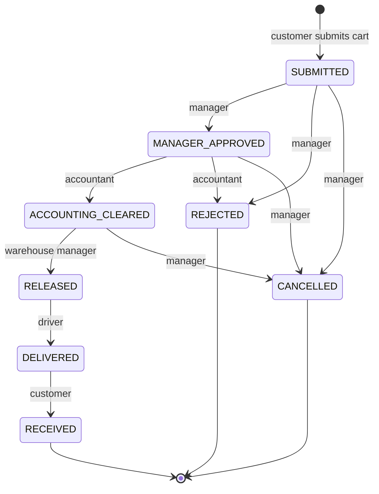

# iOrder.uz — Order Lifecycle and Permissions (Draft v0.2)

Date: 2026-10-17
Status: Proposal for review. Everything marked [P] is a proposal, not an approved business rule. [C] = already confirmed in product/discovery.md. Open items are listed in section 8.

## 1. Principles [P]

1. The order has two independent tracks: **fulfillment status** (where the goods are) and **payment status** (`UNPAID` / `PAID`). Payment never blocks fulfillment (confirmed: unpaid customers can still order).
2. The cart is not an order. An order is created when the customer submits the cart, so the first order status is `SUBMITTED`.
3. Every status change is an append-only event: who, when, from → to, optional comment. Customers see the timeline in plain language; this is the main product value (visibility of status).
4. Only one actor role may perform each transition. Illegal transitions are rejected on the server, never only hidden in the UI.
5. A transition is atomic: check current status, update the order, and write the event in one DB transaction. Two people pressing a button at the same time must not produce two transitions (guard on expected current status).
## 1.1 Confirmed decisions (2026-10-17) [C]

- The manager can edit items/quantities of an order only while it has not yet been manager-approved (status `SUBMITTED`). The customer does not have to re-confirm (may change later). See 3.2.
- Manager approval is always required, every day of the week including Saturday and Sunday. There is no auto-approve for the manager step.
- **Accounting skip is chosen by the manager, not by the calendar (changed 2026-10-20, replaces the earlier weekend-only rule).** When approving, the manager may tick a checkbox to continue without accounting approval, on any day. The order then continues without the accountant's approval, but the accountant still sees it as a new order. Details in 3.1.
- **Only the manager cancels [C, 2026-10-22, owner's words: customers and shop owners can never cancel; only the manager can].** This replaces the 2026-10-20 rule that any organization member could cancel a colleague's order, and also the rule that admin may cancel. The person who placed the order is notified with the reason as written. Cancelling stays limited to the statuses in the transition table. A customer who wants to cancel is told to contact the manager.
- Staff (managers, accountants, ...) who are members of a customer's Telegram group are NOT organization members: their Telegram IDs are ignored when reading group membership. Staff cannot place customer orders (decided 2026-10-20).
- **The warehouse works from the manager's approval on [C, 2026-10-30, replaces the 2026-10-20 rule].** After approval the warehouse sees the order and starts preparing and scanning, but cannot release it until accounting cleared it or the manager skipped accounting. Scanning stays mandatory for the release. The warehouse also sees orders that were approved and later cancelled. An order refused or cancelled before approval never reaches the warehouse. Details in 3.4.
- Cancelling always needs a reason (decided 2026-10-20; since 2026-10-22 only the manager cancels).
- **Full history (decided 2026-10-20):** every action is recorded and never lost: who did it, when, what was changed from what to what, and what was sent (notifications). This covers order actions (edits, status changes, payment status, driver assignment, cancellations, accounting skip) and other changes (prices, products, organizations, roles). See data-model invariant 10.
- "Released by warehouse" and "driver picked up" are one step. There is no separate `IN_DELIVERY`.
- A seller sees all orders of the organization they belong to. The shop_owner does not have to approve sellers' orders.
## 2. Fulfillment statuses [P]

| Status | Meaning | Customer state (2.1) |
|---|---|---|
| `SUBMITTED` | Customer placed the order | Qabul qilindi |
| `MANAGER_APPROVED` | Manager confirmed (after calling customer or directly) | Qabul qilindi |
| `ACCOUNTING_CLEARED` | Accountant confirmed; warehouse is notified | Qabul qilindi |
| `RELEASED` | Warehouse released the goods to a driver | Qabul qilindi |
| `DELIVERED` | Driver marked as delivered | Yetkazib berildi |
| `RECEIVED` | Customer confirmed receipt (final) | Yetkazib berildi |
| `REJECTED` | Manager or accountant rejected (reason required) | Rad etildi |
| `CANCELLED` | Cancelled by the manager (reason required) | Rad etildi |

### 2.1 What the customer sees: three states [C, 2026-11-09]

The customer does not need the steps inside the company. Everywhere in the customer app (orders list and its cards, order page, home page, the page after placing an order) an order shows one of three states, always in words and never by colour alone:

| Customer state | Statuses | UZ | RU | EN |
|---|---|---|---|---|
| accepted | `SUBMITTED`, `MANAGER_APPROVED`, `ACCOUNTING_CLEARED`, `RELEASED` | Qabul qilindi | Принят | Accepted |
| delivered | `DELIVERED`, `RECEIVED` | Yetkazib berildi | Доставлен | Delivered |
| refused | `REJECTED`, `CANCELLED` | Rad etildi | Отклонён | Refused |

- This is a display rule only [C]. The api still sends the real status and the app uses the real status for behaviour. The mapping lives in one tested module of the customer app (`customer-orders/domain/order-display.ts`).
- "Qabul qildim" (I received it) stays available at `DELIVERED` exactly as before [C]. After `RECEIVED` the state stays "delivered" [C]; a line under it says whether the receipt is still to be confirmed or was confirmed [P].
- Refused orders show the reason as written, as before [C].
- The six-segment progress bar is removed [C]; the state is a badge with text. [P] Badge tones: accepted amber, delivered green, refused red (the customer accent is an orange-red too close to the refusal red to stand for "accepted").
- Order history on the order page [C]: only what matters to the customer, oldest first, with the time in Asia/Tashkent: the order was accepted (placed), changes to the order (lines and quantities, the payment plan: both move the amount to pay), delivered, refused or cancelled with the reason. Manager approval, accounting, warehouse release and the driver are not listed. [P] Also listed: the customer's own receipt confirmation, and a payment plan change made by the customer inside the change window (3.3), not only the manager's. [P] A person of the customer's own organization is named; a change made by the company is signed "Menejer"; nobody else is named. Payment status changes are not listed (the payment badge shows the status).
- The payment badge keeps its rule on the real status: only after delivery (earlier only as PAID), never on `REJECTED`/`CANCELLED` [P]. The "contact the manager to cancel" hint also follows the real status: `SUBMITTED`, `MANAGER_APPROVED`, `ACCOUNTING_CLEARED`; not at `RELEASED`, although that still reads "accepted".
- List filters [C]: the status filter has the three states. "Faol" / "Yakunlangan" stay as the server groups them (`CUSTOMER_ORDER_GROUP_STATUSES`): "Faol" is everything that still needs something from someone, so it keeps a delivered order until its receipt is confirmed; "Yakunlangan" is received plus refused. [P] One filter at a time; "Hammasi" clears both.
- [P] The api filters by one status or one group, so a state filter is read by the customer app as one request per status of that state, merged newest first (same result as one server filter, more requests). A `state` query parameter on `GET /orders` would make it one request; not built because this change was limited to the customer app.
- [P] Texts of the customer app about bot messages follow the owner's rule of 2026-11-09 on customer-side bot messages (approval, refusal, manager changes; nothing on delivery): the sentence under "accepted" says the state will update in the app, and the order page and the page after placing an order promise a group message only "about important changes", not "about every change".
- [P] "My products" (unit history) follows the same rule: it shows when the unit was ordered and delivered, no longer the manager's approval (`confirmedAt` is still sent by the api and is unused by the app).

History: the per-status customer labels of 2026-10-21 (F-08: "Ko'rib chiqilmoqda", "Menejer tasdiqladi", "Buxgalteriya tasdiqladi", "Ombordan chiqdi", "Yetkazildi", "Qabul qilindi", "Bekor qilindi") are replaced by the three states; the open question whether customers see the internal steps is closed by the owner: they do not.

Note: "released by warehouse" and "driver picked up" are a single `RELEASED` step [C]. Because the manager can skip accounting (3.1), the status is named `ACCOUNTING_CLEARED` (renamed from the earlier draft name `ACCOUNTANT_APPROVED`, approved 2026-10-20); `accounting_mode` says whether it was approved or skipped.

## 3. Transition table [P]

| From → To | Actor | Required input | Side effects |
|---|---|---|---|
| (cart) → `SUBMITTED` | shop_owner, seller | non-empty cart, organization resolved | Notify managers (Telegram) |
| (none) → `SUBMITTED` on a customer's behalf (3.8) [C, owner 2026-11-20] | manager | organization, one of its current members, lines, payment plan | Notify managers (Telegram), as a customer's submit |
| `SUBMITTED` → `MANAGER_APPROVED` | manager | an allocation plan (required [C, 2026-10-30], see 3.5); payment method `CASH` / `OFFICIAL` (required [C, 2026-10-24], see 4.1); optional comment | Notify accountants, warehouse managers ("prepare", [C, 2026-10-30]) and the customer side |
| `SUBMITTED` → `REJECTED` | manager | reason | Notify the customer side, with the reason |
| `SUBMITTED` → `CANCELLED` | manager [C, 2026-10-22: customers and admin can no longer cancel]. The staff app no longer offers it on a new order: the manager rejects instead [C, owner 2026-11-20, «bitta qolsin»]; the server still allows it (API, older clients) | reason | Notify the customer side and the person who placed the order, with the reason |
| `MANAGER_APPROVED` → `ACCOUNTING_CLEARED` | accountant; or the manager, as part of the approval, when "skip accounting" is ticked (see 3.1) | optional comment | Notify warehouse managers |
| `MANAGER_APPROVED` → `REJECTED` | accountant | reason | Notify manager, warehouse managers [P] and the customer side, with the reason |
| `MANAGER_APPROVED` → `CANCELLED` | manager | reason | Notify the customer side and the person who placed the order, the accountants and the warehouse managers (who were told about the approval) |
| `ACCOUNTING_CLEARED` → `RELEASED` | warehouse manager | assigned driver | Notify driver |
| `ACCOUNTING_CLEARED` → `CANCELLED` | manager | reason | Notify warehouse, the customer side and the person who placed the order |
| `RELEASED` → `DELIVERED` | driver (the assigned one) | optional comment | None (the customer sees it in the app) |
| `DELIVERED` → `RECEIVED` | customer | optional comment | Notify manager |

"The customer side" is the organization's Telegram group. Which moves tell it is the owner's rule of 2026-11-09 [C], section 6.3; it replaces the list of 2026-10-29 (every staff-made move to `MANAGER_APPROVED`, `ACCOUNTING_CLEARED`, `REJECTED`, `CANCELLED`, `RELEASED` and `DELIVERED`). Messages for the customer side carry only the order number, status, totals and the reason as the staff member wrote it; never staff ids or accounting details.

Not allowed in MVP [P]: cancelling after `RELEASED`, moving backwards, editing status by hand. Real-life exceptions (returns, wrong delivery, partial delivery) are handled outside the system with an order comment until the rules are defined (Q5). An `admin` correction action may exist, but every use must create an audited event with a reason.

### 3.1 Accounting step and the manager's "skip accounting" option

Confirmed (2026-10-20) [C]: the manager decides whether an order continues without accounting approval, by ticking a checkbox when approving. This does not depend on the day of the week and replaces the earlier rule that only Saturday/Sunday could skip accounting. The order continues without the accountant's approval, but the accountant sees it as a new order.

Proposal for how to build it [P], pending confirmation of the details:
- Checkbox off (default): the order waits in `MANAGER_APPROVED` for the accountant, `accounting_mode = APPROVED` once the accountant approves. This is true on any day and at any hour; there is no automatic skip and no system actor.
- Checkbox on: in ONE transaction the order moves `SUBMITTED` → `MANAGER_APPROVED` → `ACCOUNTING_CLEARED`, with `accounting_mode = SKIPPED_BY_MANAGER`, both events written with the manager as actor and the skip recorded explicitly (`ACCOUNTING_SKIPPED`). The warehouse is notified immediately.
- The accountant's queue shows skipped orders as new orders (acknowledge, or flag a problem). A flag notifies the manager. It does not roll the order back once it is `RELEASED`.
- Who may tick it: the manager only [C, 2026-10-20]. Admin is a management role and does not perform workflow steps (see section 5). Whether a comment is required, and whether it is also available later for an order already waiting in `MANAGER_APPROVED`: open (Q14).
- Accounting working hours (Mon–Fri 10:00–18:00) remain a setting for display and expectations only. They no longer block or skip anything. Public holidays are no longer relevant for the workflow.
### 3.2 Manager edits [P]

- The manager can change items and quantities only while the order is `SUBMITTED`, i.e. before manager approval [C]. After approval the content is locked. If something must change later, cancel and re-submit [P].
- The manager types the quantity or steps it with minus and plus [C, 2026-11-09]; quantities stay whole pieces. Beside the field the order page shows the free stock of the product (available minus the holds of other orders, summed over its delivery lines). A quantity above it is only warned about, never blocked: the manager may still save it [C, 2026-11-09]. A product whose stock is not tracked shows no figure. A typed zero removes the line, like stepping below one [P].
- Every edit stores a before/after difference, who made it, and an optional reason.
- The customer is notified of the change. Re-confirmation is not required [C].
- Price rule [C]: the order is priced with the price list version in force when the customer submitted it. When the manager changes a quantity, prices are recalculated by the pricing rules of that same price list version. The MVP has no quantity tiers [C], so recalculation simply applies the same unit price to the new quantity, so later price list updates do not affect the order. The new price snapshot is stored and the previous one stays in the edit history.
- Price tier [C, owner 2026-11-11; Alif 2026-11-12]: the unit prices are those of the organization's price tier at submit (`orders.price_tier`, frozen; data-model "price list items"). An `ALIF_FACTORING` organization is offered only the products that have an Alif price: any other product cannot enter its cart, a line already there blocks the submit until removed (`NOT_PRICED`), and its price file leaves them out [C, no fallback].
- The customer is notified of every manager edit, with the old and new totals [C] (one of the customer-side bot messages of 6.3).
- To be re-checked with the manager later. Prices rarely change, so the risk is low (Q11).

### 3.3 Payment plan ("To'lov turi") [C, owner 2026-10-29]

- Values: `FULL` ("bittada to'lash", at the sale price "Цена") and `DEFERRED` ("bo'lib to'lash", at the deferred price "Отсрочка"). It has nothing to do with the payment method `CASH` / `OFFICIAL` ("Savdo turi", 4.1) or the payment status (4).
- The label "Savdo turi" for the payment method is confirmed [C, owner 2026-10-30].
- The customer chooses in the cart before submitting. The cart shows both totals and warns that the choice changes the price. The catalog shows the sale price only.
- Nothing is preselected [C, owner 2026-10-30]. The cart has no plan until the customer picks one. A choice is never carried into the next order.
- The choice must look and behave like a choice [C, 2026-11-09] (customers did not realise the two plans were buttons). Each plan is a card with a visible radio circle (empty / filled), the plan name and its total; the whole card is the target (at least 44px) and has hover, focus, pressed and selected states. The title says a choice is required ("To'lov turini tanlang") with a "required" mark that is a word, not a colour. Until a plan is chosen the main button of the cart summary reads "To'lov turini tanlang" instead of "Buyurtma berish" and is pressable: pressing it submits nothing, scrolls the choice into view, moves focus to its first available option and marks the choice with a ring that stays until a plan is picked (plus a short animation where motion is allowed). The button is really disabled only when ordering is blocked: a staff viewer who may not order (that state wins over "choose a plan"), a line with a problem, an unsaved quantity. The same component on the order page (the change window below) has the same look without the "required" prompting. [P] The earlier hint line "Avval to'lov turini tanlang" above the button is removed: the button says it. [P] With a problem line and no plan the button still asks for the plan first, and is disabled only after one is chosen.
- A chosen `DEFERRED` that becomes impossible (a priced line without a deferred price) clears to "not chosen" with a note, and the note disappears when it is no longer true. An empty cart or a line with a problem does not clear the choice: both may be temporary, and the submit button is blocked meanwhile.
- The request names the plan and the total the customer was shown (`expectedTotalAmount`, both required). When a price or the rate moved after the cart was read the server refuses with 409 `CART_TOTAL_CHANGED` (`details.currentTotalAmount`): no order is created and the cart stays; the customer's cart re-reads and shows the new totals with a message. An idempotent replay returns the existing order, whatever total it states.
- A cart with a product that has no deferred price cannot choose `DEFERRED`: the option is disabled with the reason, a price is never guessed. The server refuses it too (409 `DEFERRED_PRICE_UNAVAILABLE`, `details.productIds`), also when the price disappeared between viewing and submitting. The request must name the plan; the server has no default.
- After submitting, the customer may change ONLY the plan [C, owner 2026-10-30], within a window of 3 minutes from `submitted_at` (env `PAYMENT_PLAN_CHANGE_WINDOW_SECONDS`) and only while the order is `SUBMITTED`: `PUT /orders/:id/payment-plan` with the plan and `expectedRowVersion`. The server decides using the application Clock; at the end instant it refuses with 409 `PAYMENT_PLAN_WINDOW_ENDED`, on another status with 409 `PAYMENT_PLAN_NOT_CHANGEABLE`, a stale version with 409 `ORDER_CHANGED`. The customer order answer has `paymentPlanChangeableUntil` and `paymentPlanTotals` (both null outside the window, and never the per-line snapshots); the order page shows the two options, their totals and a countdown with the end time, and hides the control when the time ends or the server refuses.
- [P] Any member of the organization who may see the order may make that change, not only the person who placed it. [P] The managers get a staff notification through the outbox (`ORDER_PAYMENT_PLAN_CHANGED`, role `MANAGER`), because the total moved and they may be looking at the order; the customer's chat gets none. The order event's actor is the customer.
- [P] The owner also said "before the manager sees it". Opening an order is not tracked and this is not built: only the time and the status close the window.
- The manager may change the plan while the order is `SUBMITTED` (otherwise 409 `PAYMENT_PLAN_NOT_CHANGEABLE`), with no time window. Prices and total are recomputed from the order's own snapshot, never from the current price list (hard rule 4); the same deferred-price check applies to the snapshot. One transaction, guarded by the row version: a `PAYMENT_PLAN_CHANGED` order event (plan and total, from and to, with all lines) and one message to the customer's chat, as with an item edit. Choosing the plan the order already has writes nothing.
- The two price snapshots of a line are immutable after insert (a trigger), and the charged price must be one of them (a CHECK that also holds on a line without a deferred snapshot).
- Visible to the customer on their own order and to manager, accountant and admin. Warehouse and driver do not get totals, so they do not get the plan or its event either.
- Orders older than the plan are `FULL` and their lines have no deferred snapshot, so they cannot move to `DEFERRED`.
- [P] The cart bar on the catalog always names its plan: the chosen plan with its total, otherwise the sale total labelled "if paid in full". While no plan is chosen the cart's lines name both prices and show no line total. [P] An optional `reason` on the manager's change goes to the customer's timeline like an edit reason; the staff screen does not ask for one yet. [P] The change writes no `audit_log` row (an item edit does not either; the order event is the record, hard rule 12).
### 3.4 Warehouse flow [C, 2026-10-30]

- [C] From `MANAGER_APPROVED` the warehouse sees the order (the money-free fulfilment view: no price, total, payment method or plan) and scans codes. One `order_units` row per piece is created at the approval.
- [C] `RELEASED` still starts only from `ACCOUNTING_CLEARED`, and only with every required code scanned. The warehouse's queue names three groups: "prepare, accounting pending" (the release button is shown and locked), "ready to release", and "return the goods".
- [C] The warehouse also sees orders approved and later cancelled.
- [P] The accountant's rejection after approval is treated the same way as a cancel after approval: visible to the warehouse, the warehouse is told, the goods go back.
- [P] Rejecting or cancelling voids the codes scanned so far (`ORDER_REJECTED` / `ORDER_CANCELLED`), under the order row lock that scans also take, so a scan in the same moment cannot leave a live code on a closed order.
- [P] The warehouse confirms with a "Returned" button (`POST /staff/orders/:id/goods-returned`, `MARK_GOODS_RETURNED`, warehouse only): `goods_returned_at/by` and a `GOODS_RETURNED` order event in one transaction, once. It never changes the status. Not shown to customers; manager, accountant, admin and warehouse see it in the timeline. It does not check that goods were really prepared: an order nobody touched is confirmed the same way. No message is sent.
- Orders closed before this rule do not prompt: the migration gave them a return time without a person, and no event was invented.
- [C] Bot messages: a normal approval sends the warehouse "prepare" (`ORDER_READY_TO_PREPARE`), the clearance later sends "ready" (`ORDER_ACCOUNTING_CLEARED`). The skip sends only "ready": one approval, one message. [P] Messages to the warehouse and the driver no longer carry the order total, matching their money-free view.
### 3.5 Stock holds and FIFO [C, 2026-10-30]

The sheet's «Доступное кол-во» drops by itself when the manager ships from their own sheet, and the 10-minute sync mirrors it. iOrder never subtracts permanently. It holds stock from the manager's approval until `RELEASED`, `REJECTED` or `CANCELLED`; the holds end in the same transaction as the status. A customer's submit never takes a hold and never waits for one; since 2026-11-09 it is refused only when a line asks for more than the free stock the customer is shown (3.7).

- **Approval:** `GET /staff/orders/:id/allocation-preview` (manager) gives the FIFO proposal per order line, what is short, the earlier `SUBMITTED` orders that want the product, and when a sync last changed a line. `POST .../approve` carries `allocationMode` and `allocations[]`. The manager cannot approve without a plan.
- **Re-check:** in the approval's transaction. `STOCK_INSUFFICIENT` (409) when the free lines cannot cover the order, zero stock included: the manager lowers the quantity, rejects or syncs. `ALLOCATION_CHANGED` (409, the fresh plan in `details.preview`, one click to confirm) when a `FIFO` plan is no longer the FIFO, or a `MANUAL` plan no longer fits its lines. A request that does not add up or names another product's line is 422.
- **Lock order, everywhere:** `price_reference_sync` advisory lock, then the order row, then the writes. A sync takes the same lock and never locks an order, so neither waits for the other in a circle. The row comes before the inserts because their foreign keys lock the order lines, and an item edit takes the order row and then the lines.
- **After approval:** nothing changes by itself. When a sync leaves a line below its holds, or a manager confirmed its removal, the preview shows a flag and the ready FIFO alternative; this order's own shipment may be why. Until `RELEASED` the manager may move the holds: `POST /staff/orders/:id/allocations`, old rows voided, new rows added, one `ALLOCATION_CHANGED` event with before and after. The row version does not move, so an accountant's or warehouse decision in progress stays valid.
- **History:** the approval's event holds the plan and its mode; `RELEASED`, `REJECTED` and `CANCELLED` events hold `holdsEnded`. `ALLOCATION_CHANGED` shows only in the full staff timeline, never to the warehouse, the driver or a customer. The sheet is never written (hard rule 10).
- **Products outside the plan [C, 2026-11-09]:** an order line whose product is a staff-added product without a sheet «Товар_ID» (`products.code_generated`, data-model "Staff-added products") has no delivery lines and is outside the plan: it asks for nothing (`demandOf` skips it), never holds and is never `STOCK_INSUFFICIENT`; `allocations[]` rows naming such a line are refused: in `MANUAL` mode as not a line of this order (422), in `FIFO` mode the plan then differs from the fresh FIFO (409 `ALLOCATION_CHANGED`, the fresh plan in `details.preview`). The preview item carries `stockTracked: false` with empty `lines`, `fifo`, `current` and a zero `shortQuantity`; the staff order lines, the fulfilment lines and the picking lines carry the same flag (sheet products: `stockTracked: true`). An order of ONLY such lines is approved with an empty `allocations` array (`allocationMode` is still sent). The "plan required" rule above applies to the tracked lines of the order. A later merge of the product into a sheet product changes nothing on existing orders (snapshots).

### 3.6 A locked step says why [C, owner 2026-11-09]

The owner: "sometimes the approve button is disabled; on hover the reason must be shown, on mobile a modal window must say why". A step button of the staff order page that cannot be pressed is therefore never a dead button: it is announced as disabled (`aria-disabled`) but still takes focus, hover and a tap. Hover and keyboard focus show the reasons in a tooltip, a touch tap opens a small dialog with them, the first reason is printed under the button, and the action itself never runs while a reason is left (the server stays the authority either way). One ordered list of reasons per action, the first thing to do first [P]:

- **Approve** (order page, queue card, the dashboard's approval dialog): a request is running; (dialog only) the order is still loading or could not be loaded; unsaved item edits; the stock plan (loading, could not be loaded, no access, closed, the stock is short and of which product, the chosen supplies do not add up and for which product); no sale type chosen. Items, then stock, then the sale type: the order of the screen and of the work.
- **Reject:** a request is running; unsaved item edits (a rejection would silently drop them).
- **Release:** a request is running; accounting has not cleared the order (3.4); the unit codes (being read, could not be read, N of M scanned); the driver (list loading, could not be loaded, no active driver, none chosen).

Not covered: cancel, the accounting decision, "goods returned" and "delivered" are locked only while their own request runs (the button then shows a spinner), so they have nothing to explain.

### 3.7 What the customer may order: the stock figure and its cap [C, owner 2026-11-09]

Owner's decision (`prompt.md` and answers, 2026-11-09), replacing "customers are not blocked on submit" and the tentative stock visibility setting:

- **The figure.** When choosing a product the customer sees how many pieces can be ordered, as an exact number ("45 dona bor"). It is the FREE quantity: the product's available stock of 3.5 (each live delivery line's sheet quantity minus that line's active holds, never below zero, added up), which is exactly "Mavjud" on the staff Qoldiq page, in whole pieces (a fraction is dropped, never rounded up). Holds of approved orders of EVERY organization lower it; an order that is only `SUBMITTED` holds nothing and lowers nothing. The sum is floored once, as the staff page shows it [P]: fractions on two delivery lines of the sheet can add up to a piece the plan cannot take from either line (3.5 takes whole pieces per line); the approval then answers `STOCK_INSUFFICIENT`, as it does for any stock that fell.
- **Out of stock: a figure of zero.** A TRACKED product (it has a stock aggregate and is not staff-added) whose free quantity is exactly zero, whether the sheet says zero or approved orders hold everything, gets `orderableStock: 0` [C, owner: "an unknown stock is not counted as a limit; only an exact 0 blocks"; the only consistent rule: a product with 3 pieces is capped at 3, so one with none cannot be unlimited]. It is shown as out of stock in words ("Qolmagan" / "Нет в наличии" / "Out of stock", never "0 dona bor"), it cannot be put in the cart or increased (the server answers 409 `STOCK_LIMIT_EXCEEDED` with `orderableStock: 0`; the app shows the add control off with the reason next to it, and a press on it says why instead of doing nothing), and a cart line it ran out under is the problem `STOCK_EXCEEDED` with a figure of 0 whose one-tap action is to REMOVE the line ("Omborda qolmagan. Qatorni olib tashlang."): there is no quantity to lower to, so the line has no stepper. Submit refuses it like any over-stock line. In the catalog such products stay visible, toned down, and sort after the others within their category by the list's figure [P: sorting by the fresher cart figure was rejected, it would reorder cards under the person's finger], EXCEPT when the sheet itself says zero (next point). The pieces come back as soon as the sheet shows some or a hold ends.
- **The sheet says zero: not listed [C, owner 2026-11-19].** A product linked to the sheet by its «Товар_ID» (not a staff-added "By order" product) whose SHEET available quantity («Доступное кол-во», added up over its live delivery lines = `stock_cache.quantity`) is zero is left out of the customer price list (`GET /price-list/current`, the home recommendations) and out of the price list Excel file (the group post and the staff download). Only the sheet figure decides: a product whose sheet stock is held entirely by approved orders stays listed as out of stock (previous point). Unknown stock (no aggregate) and staff-added products are never left out. The staff pages are unchanged (the manager still sees and prices it). The cart still knows the product: a line that ran out under the customer stays the `STOCK_EXCEEDED` problem with its prices, and adding it is refused with `STOCK_LIMIT_EXCEEDED` as before. It comes back by itself when a sync shows stock again. A tier whose file would then be empty is not posted. One rule: `isSoldOutInSheet` (`pricing/orderable-stock.ts`); a negative sheet sum counts as zero [P].
- **No figure, no cap.** A product whose stock is unknown (no stock aggregate at all) or not tracked (a staff-added product, `products.code_generated`, whatever rows may exist for it) has no figure: the answer carries `null`, the customer sees nothing at all, and any quantity can be ordered (the company brings such goods on order). The customer must not be able to tell such a product from any other, and in particular must not be able to confuse it with "out of stock": the item has the same fields, the app shows no label and no toned-down state for it, and its add control works.
- **The cap.** The quantity of a cart line cannot exceed the figure. The SERVER enforces it: setting or adding a cart quantity above the figure answers 409 `STOCK_LIMIT_EXCEEDED` with `details.lines = [{ productId, orderableStock }]` (the CURRENT figure, so the app can show it) and changes nothing, also when a line that is already above the figure is lowered but not far enough. The customer app limits the field and the plus button to the figure and says why ("Omborda faqat 45 dona bor"); that is a courtesy, the server is the rule.
- **The stock fell after the product was put in the cart.** The cart line gets the problem `STOCK_EXCEEDED`: unlike the other problems the product is still orderable, so the line KEEPS its prices and counts in the cart totals, `orderableStock` says how many are left, and `canSubmit` is false. The app shows "Omborda faqat 4 dona qoldi. Miqdorni kamaytiring." with a one-tap "4 dona qoldirish", and keeps the line's stepper (at a figure of 0, see above: the one tap removes the line). A removed line of this kind is offered back ("undo") at the figure, not at the refused quantity; one whose stock ran out is not offered back [P].
- **Submit.** The stock is read again inside the submit transaction, after the cart lock (through the pricing module's own connection, like the price list). A line above the figure refuses the order with the same 409 `STOCK_LIMIT_EXCEEDED` (every such line in `details.lines`); no order is created and the cart stays. Checked after `PRODUCT_NOT_ORDERABLE` and `DEFERRED_PRICE_UNAVAILABLE`, before `CART_TOTAL_CHANGED` [P].
- **Not a reservation (hard rule 10).** A cart holds nothing and a submitted order holds nothing: two customers may each put the last pieces in their carts and each submit them. The manager's allocation at approval (3.5) settles it, as before (`STOCK_INSUFFICIENT`, lower the quantity or reject).
- **Who is bound.** A customer's cart and a staff viewer's personal cart alike (`carts.organization_id` NULL). The manager's later edits of an order (3.2) are NOT capped: staff see a warning only.
- **Where the figure travels.** `orderableStock` (a JSON integer of whole pieces, 0 = out of stock, or null) on the items of `GET /price-list/current`, on every cart line, and in the refusal's details. Nowhere else: not in an order, the order list, the timeline or a notification. It is one total over all customers: no cost, no supplier, no delivery line, nothing about who holds what. The raw sheet quantity and the held quantity stay staff-only. One fixed set of queries for the whole list (the stock aggregate of the listed products, then one aggregate over their delivery lines and holds).

### 3.8 The manager's order on a customer's behalf [C, owner 2026-11-20]

Owner's decision (2026-11-20): "Manager nomidan ham buyurtma yaratilishi kerak". The MANAGER creates an order for a customer from the staff app (the «+ Yangi buyurtma» button on the Buyurtmalar list, approved design «02-yangi-buyurtma»: 1 Mijoz → 2 Tovarlar → 3 Tafsilotlar → 4 Tasdiq). Only the manager [C]: not the admin (management only), not the purchasing manager (read-only), nobody else (permission `CREATE_ORDER_FOR_CUSTOMER`, checked on the server).

- **Who it is for.** The manager picks an ACTIVE, not archived organization. A GROUP: one of its CURRENT members is chosen; a PERSON: its one member is used. That member becomes the order's `placed_by`, so the customer side sees an ordinary order of its organization. The server checks that the person is a current member of THAT organization with an active, non-staff account; otherwise 409 `PLACER_NOT_MEMBER` (hard rule 6). The contact (name and phone) a customer's first order asks for is not asked here [P]: the manager knows who they are ordering for.
- **The same order as a submit.** It is created in `SUBMITTED` through the same writer as the customer's submit: priced from the current published list at the organization's tier (`PRICE_TIER_OF_LABEL`; Alif factoring offers only products with an Alif price, others are refused with `PRODUCT_NOT_ORDERABLE`), both price snapshots kept, the USD rate frozen, `price_tier` frozen, the same `ORDER_SUBMITTED` staff messages (managers, and the purchasing manager for marked goods). The customer side gets nothing on submit, whoever placed it (`CUSTOMER_SIDE_NOTIFICATIONS`, 6.3). Manager approval stays a separate, later step.
- **History (hard rule 12).** The `SUBMITTED` event's actor is the MANAGER who created it (role `MANAGER`); its payload names the organization and the member it was placed for (`createdOnBehalfOf`) and the comment. The customer timeline shows the step like any staff step (role only).
- **Plan.** Required, nothing preselected (step 3 rings the block and says why when «Keyingi» is pressed without one). `DEFERRED` is refused when a line has no deferred price (`DEFERRED_PRICE_UNAVAILABLE`). The total the manager saw is sent (`expectedTotalAmount`): a price that moved refuses the order (`CART_TOTAL_CHANGED`) instead of storing a total nobody saw.
- **Stock [P].** Step 2 offers the organization's own customer catalog: sheet products whose SHEET stock is zero are not offered (`isSoldOutInSheet`, 3.7) and the server refuses them (`PRODUCT_NOT_ORDERABLE`); staff-added "By order" products are offered, without a stock figure. The app's step 2 also hides a tracked product whose FREE stock is exactly 0 (approved orders hold everything; the design: «Omborda yo'q tovarlar ko'rinmaydi»); unknown stock stays shown. That is display only: the server does not refuse such a product. Asking for more than the free stock is only a WARNING in the app («Omborda atigi N dona») and is NOT refused by the server, consistent with the manager's uncapped edits (3.2). Nothing is held at creation (hard rule 10): holds come with the approval (3.5).
- **Comment.** «Izoh» is stored in the order's existing comment field (`orders.customer_comment`); empty = none. The customer reads that field on their order, so the field says so under it («Mijoz ham ko'radi»).
- **The placer's own rights [P].** The member the order is placed by may change its payment plan within the usual window after submitting (3.3, default 3 minutes from `submitted_at`), exactly as after their own submit; nothing here limits it.
- **Messages [P].** The creating manager gets the staff "new order" bot message too, like every manager (6.1); it is not filtered out for its author.
- **The checks at creation.** The membership and the account are checked inside the create transaction, after its advisory lock, under the organization's and the person's row locks, so a member who leaves or is blocked a moment earlier cannot become `placed_by`. Step 1 offers only members whose account is active. A new `Idempotency-Key` is used whenever the customer, member, lines, plan or comment change in the app; only a retry of the unchanged order keeps its key. The draft lives in memory and is emptied when the session changes.
- **Idempotency.** `POST /staff/orders` takes an `Idempotency-Key` like the customer submit (unique per organization): a retry returns the same order and creates nothing; the same key from another person answers `IDEMPOTENCY_KEY_REUSED`.
- **Step 1 reads.** `GET /staff/orders/new/customers` finds ACTIVE organizations by name, member name or member phone, by type and label, with their current members (staff-only DTO). Its `recent` list («Oxirgi mijozlar») is the organizations of the latest orders, newest first, at most 4 [P]. `GET /staff/orders/new/catalog?organizationId=` gives step 2 the tier prices, category, brand, photo and the free stock as a hint.
- **Not built [owner 2026-11-20].** The design's "another manager is editing" lock (🔒) is not wanted now.

## 4. Payment status and the organization's debt [C, 2026-10-26]

Replaces the earlier manual PAID / UNPAID (owner with the manager, 2026-10-26). The debt is counted in USD [C, owner, relayed 2026-10-30: "Organization debt is calculated with the rate at the time the order was placed (default USD)"].

- **Debt per organization, not per order, in USD [C].** An organization owes the USD total of its `RECEIVED` orders minus the USD value of its payments that are not voided. One amount; cash and official are not separated. An order counts from the moment it becomes `RECEIVED` (`orders.received_at`).
- **An order's rate is frozen at submit [C].** Each order keeps the USD rate from when it was placed and its USD total. An item edit or a plan change recomputes the USD total with that stored rate, never the current one. The rate is the one that priced the order's so'm prices (same read) [P].
- **USD total [P].** The sum of the lines' USD values, kept at 6 decimals, half up. A line whose charged price has a USD snapshot is quantity x that price, so a USD list's order counts exactly what it was sold for (order_items keeps both USD prices, immutable). A line priced in legacy so'm, or older than the snapshots, is its so'm line total / the frozen rate. Reason: the so'm price of a USD item is rounded per unit, so converting the so'm total back gave $1.20 x 5,000 at 12650.55 = $6000.13 and an exact $6000.00 payment left the order `UNPAID`.
- **The half cent [P].** A difference in USD under $0.005 (`USD_SETTLED_UNDER`, one constant, compared by a test with the migration's copy) is settled: the order is `PAID`, the balance shows zero, not "due" and not "overpaid", and the customer's amount is zero. Reason: so'm amounts converted one by one cannot add up exactly: two orders of 15,000 so'm and a payment of 30,000 at 12650 differ by millionths, and at two decimals they differed by a cent, leaving an order settled in so'm `UNPAID`. It is one half cent over the whole walk, not one per order. Displays stay at 2 decimals; a real difference (half a cent or more) shows as at least $0.01.
- **No known rate at submit [P]:** an order is refused (409 `CURRENCY_CONVERSION_UNAVAILABLE`, nothing written, the cart stays) rather than stored with an unknown debt. USD-priced items already cannot be ordered then; this also covers a cart of only older so'm prices.
- **Only the manager records a payment**, for the ORGANIZATION, never for an order: amount, currency chosen per payment (USD or so'm [C]), a required positive rate on a so'm payment [C] (the USD value is computed and stored), the day it was paid (Asia/Tashkent; may be in the past, never in the future), optional comment. Audited (`ORGANIZATION_PAYMENT_RECORDED`). A USD payment has no rate. A so'm payment worth under half a cent at its rate is refused (422 on `amount`) [P]. The staff form has no default currency: the manager picks USD or so'm before the amount can be typed, the amount's label names the currency, and a confirm step shows the amount in both currencies and the debt after the payment; a so'm payment's rate is prefilled with the current one and can be changed [P]. The admin's correction form starts from the payment's currency, names it the same way and has the same confirm step [P].
- **Only the admin corrects a wrong payment** (amount, currency, rate, day, comment; a reason is required) or voids it (reason required). The USD value follows. Switching to so'm needs a rate; switching to USD drops it. Both are audited with before/after; a payment is never deleted; a voided payment is final (409 `PAYMENT_VOIDED`).
- **Overpayment** is kept and shown as "overpaid"; what happens to it is decided later [T].
- **Order `PAID` / `UNPAID` is derived**, nobody sets it by hand (the manual action was removed): the payments cover the received orders oldest first (by `received_at`, then order number), compared in USD [C]; an order is `PAID` only when it is covered in full (within the half cent [P]), the first order not covered takes the rest and it and every newer one stay `UNPAID`. An order is covered only by money really left for it [P]: an order worth almost nothing is never `PAID` without a payment, nor ahead of an older `UNPAID` order; such an order alone stays `UNPAID` though the balance shows zero, until more money comes in. Orders that are not `RECEIVED` are `UNPAID`. It is recomputed in the same transaction as whatever changed the debt (a payment, a correction, a void, an order becoming `RECEIVED`), with one `PAYMENT_STATUS_CHANGED` order event per order that changed (actor = the person whose action caused it). Example (figures in USD): orders of 2000 and 3000 received, 2700 paid → first order `PAID`, second `UNPAID`, 2300 due.
- **Display [P].** Staff see the debt and the payments in USD with the so'm equivalent at the CURRENT rate setting (the so'm equivalent is display only, and is hidden while no rate is known). **The customer keeps seeing so'm** (hard rule 1): the USD debt converted with the current rate setting, whole so'm half up, only the amount. So the figure a customer sees moves when the rate moves, and it need not equal the sum of their so'm order totals. The owner's "default USD" may be meant for customers too; asked. If an amount is due and no rate is known, the customer's call answers 409 `CURRENCY_CONVERSION_UNAVAILABLE` instead of a guess.
- **Existing data [P]:** orders and payments older than this rule took the `usd_rate` setting current at migration time (`20261114090000_usd_organization_debt`); old payments are so'm payments at that rate. Every backfilled payment and order gets one `audit_log` row, actor system (`MIGRATION_USD_PAYMENT_BACKFILLED`, `MIGRATION_USD_ORDER_BACKFILLED`); the order rows go there, not to `order_events`, because a backfill is not a workflow step and an event would show on the customer's timeline [P]. The migration re-derives `PAID` / `UNPAID` in USD: an order settled exactly in so'm stays `PAID` with no event; a real difference keeps its `PAYMENT_STATUS_CHANGED` event (actor `SYSTEM`), and that event is customer-visible. Two such cases: a stored `PAID` the live payments do not cover, and an `UNPAID` order short by under half a cent (about 63 so'm at 12650), which becomes `PAID`. Without a valid setting it fails on existing rows, changes nothing and succeeds on empty tables; prisma then blocks every later deploy with P3009 until `prisma migrate resolve --rolled-back 20261114090000_usd_organization_debt` is run after the rate is set (the error message says so).
- **Unpaid orders figures [P].** The dashboard card and list and the customers page show the gross total of `RECEIVED`, `UNPAID` orders, labelled "unpaid orders": in USD (each order at its rate from submit, from `GET /staff/orders/counts`, FULL roles only) with the so'm equivalent at the current rate when one is known. They are not the balance: a partial payment leaves them unchanged while the balance goes down.
- **Who sees it:** manager, admin and accountant [P for the accountant] see the balance and the payments, and the order's rate and USD total on the order; the rates and USD figures are staff-only (cost-class). The customer (shop owner and seller) sees only the amount their own organization has to pay [P: no payment list]. Warehouse and driver see nothing.
- Never blocks ordering or the workflow (hard rule 11). Due dates, payment allocation chosen by hand: not in MVP.

### 4.1 Payment method [C, 2026-10-24]

- Values: `CASH` ("Naqd") and `OFFICIAL` ("Official"). Chosen per order, never a per-customer default.
- The manager MUST choose it when approving (`SUBMITTED` → `MANAGER_APPROVED`, with or without "skip accounting"); the approval is rejected without it. The choice is recorded in the approval event (before/after).
- The manager may change it later while the order is approved and not rejected or cancelled (`MANAGER_APPROVED`, `ACCOUNTING_CLEARED`, `RELEASED`, `DELIVERED`, `RECEIVED`). Each change is a `PAYMENT_METHOD_CHANGED` order event plus an audit row, with an optional comment; setting the same value writes nothing. No row version and no notification [P].
- Visible only to the manager, the accountant and, [C, 2026-10-30], the purchasing manager (who reads and never changes it). Admin, warehouse, driver and customers never see it (not in their responses, not in their timeline).
- Separate from the payment status (`UNPAID` / `PAID`) and from fulfillment: it never blocks or moves an order.
- Open [P]: whether the admin should see it (the owner named only manager and accountant); whether a change after `RECEIVED` should be allowed (allowed for now).
- **What the accountant sees [C, owner 2026-10-30].** Per order: supply id, product id, product name, price, line total and party number; a line split over supplies shows how many pieces belong to each. `CASH`: a clear warning that this is a cash sale and that there is no invoice ("счёт-фактура"), with the order's details and total; the accountant still approves. `OFFICIAL`: the details plus Savdo turi (`paymentMethod`) and To'lov turi (`paymentPlan`), two separate names.
- **Order details by role [C, owner 2026-10-30].** Manager and accountant: the above. Warehouse: supply, party, product, quantity; never a price, a total or the payment method. An approved order older than the holds reads "Not allocated". Customers never see a supply or a party.
- [P]: the admin's full view has the supplies too, and the driver's view has none (the field is absent, like the unit codes). The cash warning shows to the accountant only. Both facts are also on the closed card of the accounting queue. The product id shown is the sheet's «Товар_ID» (`productCode`).

## 5. Roles and permissions matrix [P]

Legend: ✔ allowed · O = own orders only · Org = own organization's orders · — not allowed

| Action | shop_owner | seller | manager | accountant | warehouse | driver | admin | purchasing manager |
|---|---|---|---|---|---|---|---|---|
| Browse price list | ✔ | ✔ | ✔ | ✔ | — | — | ✔ | ✔ (read) |
| Submit order (staff: only as a staff viewer in the customer app, only on staging, into the one configured test organization; see below) [C, 2026-11-09] | ✔ | ✔ | — | — | — | — | — | — |
| View order and timeline | Org | Org [C] | all | all | approved+ [C, 2026-10-30] (and cancelled orders that had been approved [C]; accountant-rejected ones [P]) | assigned | all | ✔ (read) |
| Create an order on a customer's behalf, placed by one of its current members (3.8) [C, owner 2026-11-20] | — | — | ✔ | — | — | — | — | — |
| Edit items / quantities (only while `SUBMITTED`) | — | — | ✔ | — | — | — | — | — |
| Cancel order (only the manager [C, 2026-10-22]; customers are told to contact the manager) | — | — | ✔ | — | — | — | — | — |
| Approve / reject (manager step) | — | — | ✔ | — | — | — | — | — |
| Skip accounting while approving (3.1) | — | — | ✔ | — | — | — | — | — |
| Approve / reject (accounting step) | — | — | — | ✔ | — | — | — | — |
| Release goods, assign driver (refused until every required unit code is scanned [C, 2026-10-25]) | — | — | — | — | ✔ | — | — | — |
| Scan IMEI / SN / marking per unit while picking (`MANAGER_APPROVED`, `ACCOUNTING_CLEARED`) [C, 2026-10-25, opened at approval 2026-10-30] | — | — | — | — | ✔ | — | — | — |
| Confirm the goods of a closed order were returned (3.4) [P] | — | — | — | — | ✔ | — | — | — |
| See the scanned unit codes of an order (staff) | — | — | ✔ | ✔ | approved+ | — | ✔ | ✔ (read) |
| See own organization's received goods and their codes (My Products, orders `RECEIVED`) [C, 2026-10-25] | Org | Org | — | — | — | — | — | — |
| Manage product categories and a product's code rule (category = template) [C, 2026-10-25] | — | — | ✔ | — | — | — | ✔ | — |
| See own organization's home recommendations (reorder, matching products, the confirmed newer model; data-model "Newer-model pairs") [C, 2026-11-09] | Org | Org | — | — | — | — | — | — |
| Confirm or reject a newer-model pair, run the proposal generator (staff page Yangi modellar) [C, 2026-11-09] | — | — | ✔ | — | — | — | ✔ | ✔ (read) |
| Mark delivered | — | — | — | — | — | assigned | — | — |
| Confirm receipt | ✔ (Org) | O | — | — | — | — | — | — |
| Record a payment for an organization (4) [C, 2026-10-26] | — | — | ✔ | — | — | — | — | — |
| Correct or void a payment (4) [C, 2026-10-26] | — | — | — | — | — | — | ✔ | — |
| See an organization's debt and payments (4) | — | — | ✔ | ✔ [P] | — | — | ✔ | ✔ (read) |
| See own organization's amount to pay (4) [C, 2026-10-26] | Org | Org | — | — | — | — | — | — |
| Choose the payment method while approving, change it later (4.1) [C, 2026-10-24] | — | — | ✔ | — | — | — | — | — |
| See the payment method (4.1) [C, 2026-10-24] | — | — | ✔ | ✔ | — | — | — | ✔ (read) |
| Choose the payment plan when submitting (3.3) [C, 2026-10-29] | ✔ (Org) | ✔ (Org) | — | — | — | — | — | — |
| Change the payment plan while `SUBMITTED` (3.3) [C, 2026-10-29] | — | — | ✔ | — | — | — | — | — |
| Change the payment plan inside the window after submitting (3.3) [C, 2026-10-30; any member [P]] | Org | Org | — | — | — | — | — | — |
| See the payment plan (3.3) [C, 2026-10-29] | Org | Org | ✔ | ✔ | — | — | ✔ | ✔ (read) |
| Update price list (selling prices; the accountant can never change them) | — | — | ✔ | — | — | — | ✔ | — |
| View cost reference and the USD rate (staff-only) | — | — | ✔ | ✔ | — | — | ✔ | ✔ (read) |
| See the by-order products and what open orders wait for (staff page "Buyurtma orqali", data-model "Staff-added products") [C, 2026-11-09; the roles of the stock page [P]] | — | — | ✔ | ✔ | — | — | ✔ | ✔ (read) |
| Change the USD rate | — | — | ✔ | — | — | — | ✔ | — |
| Search supplies and set a party number on them [C, 2026-10-30] | — | — | ✔ | — | — | — | — | — |
| Configure Telegram schedule | — | — | ✔ | — | — | — | ✔ | — |
| Edit customers / organizations, assign shop_owner | — | — | ✔ | — | — | — | ✔ | — |
| "Delete" (archive) and restore an organization; never a hard delete (data-model "Archiving an organization") [C, owner 2026-11-13] | — | — | — | — | — | — | ✔ | — |
| List active drivers (id and name only; to choose a driver when releasing) | — | — | ✔ | — | ✔ | — | ✔ | — |
| Manage staff accounts and roles | — | — | — | — | — | — | ✔ | — |
| Set or reset a staff member's website login and password (a manager cannot change an administrator) [P] | — | — | ✔ | — | — | — | ✔ | — |
| Create staff accounts, list them, link or unlink their Telegram id (a manager cannot grant ADMIN or touch an administrator; owner request 2026-10-22: only manager and admin) [P] | — | — | ✔ | — | — | — | ✔ | — |
| Press the sheet sync [C, 2026-10-30] | — | — | ✔ | — | — | — | ✔ | ✔ |
| Read customers, organizations, products, categories, brands, price versions and history | — | — | ✔ | — | — | — | ✔ | ✔ (read) |
| Read the staff list without logins, password facts or Telegram ids [P] | — | — | ✔ | — | — | — | ✔ | ✔ (read) |
| Own bot connection and profile | — | — | ✔ | ✔ | ✔ | ✔ | profile | ✔ |

The purchasing manager [C, 2026-10-30] sees every page the sales manager sees, read-only, including cost, Savdo turi and customer payments, and may press the sheet sync. It never approves, rejects, cancels, edits items or plans, enters prices or the rate, changes stock, sets parties, records payments, edits customers, or manages logins, passwords or Telegram ids. No Telegram id reaches it: the responses carry those fields as null [P].

Rules that must hold regardless of UI:
- A customer can never read another organization's orders, prices, or discounts (data isolation, enforced in queries, not in the frontend).
- Warehouse sees an order only from `MANAGER_APPROVED` (including later cancelled or rejected ones that had been approved); driver only orders assigned to them.
- Staff are never organization members, so a staff person can never act as a customer.
- Staff in the customer app [C, 2026-11-09]: a staff member may open the customer app and is a **staff viewer** there, not a customer and not a member. No staff role applies on the customer routes. The viewer browses the published price list through the customer DTOs and has a personal cart with no organization; orders, the amount to pay and received goods are empty; nothing of any real organization is visible. Placing an order is refused by the server unless `STAFF_ORDERING_ORGANIZATION_ID` names an ACTIVE organization (staging only): the order is then an ordinary order of that one test organization, placed by the staff member and recorded in their staff role, and it goes through the same submit and the same transitions as any order. Production never allows it. [P]: viewers are the roles with "Browse price list" above (not warehouse or driver); a viewer reads only the test orders they placed and performs no step on them (no receipt, no plan change). Details: `docs/architecture/customer-website-auth.md`.
- Admin is a management role [C, 2026-10-20]: it configures the system (prices, schedule, customers, roles, settings), and sets payment status, but it does not perform the workflow steps (manager/accounting approval, item edits, release, delivery, receipt) and does not cancel (only the manager cancels, 2026-10-22). Each of those stays with its own role, so the history always shows who really did it.
- `dev` is not a business role: it is developer/operational access and should not appear in customer-facing flows (Q9).
## 6. Notifications [P]

Telegram bot messages on transitions (see side effects above): staff get theirs for every step of their role (6.1), the customer side only for the events of 6.3. The sender is built (outbox dispatcher, UZ/RU/EN templates; see `autonomous-work-log.md`). The bot can message a user only if the user has started/allowed the bot; a group gets messages while the bot is a member. Fallback: in-app status timeline is always the source of truth.

### 6.1 Staff bot notifications [C, 2026-10-25]

- Every staff member **except an administrator** gets a private bot message for each order update that concerns their role (the side effects above: managers, accountants, warehouse managers, the assigned driver). A person who holds ADMIN and another role gets the messages of the other role.
- Under the message there are two buttons that open **that order**: "Open on the website" (the staff web app) and "Open in the Mini App" (the same page as a Telegram Mini App). The order link is no longer written in the text. Since 2026-11-09 the second button opens the registered staff Mini App (`TELEGRAM_STAFF_MINI_APP_URL`, `?startapp=order_<order id>`) when one is configured; the staff member is signed in automatically there [C, 2026-11-09]. Without the setting it stays a `web_app` button, or is absent when a separate staff bot signs staff in (`docs/architecture/customer-website-auth.md`, "The staff Mini App").
- The bot can only write to someone who started it. A staff member who has no Telegram id, or has not started the bot (or blocked it), sees a reminder in the staff app with a "Turn on notifications" button. It opens a one-time `https://t.me/<bot>?start=<token>` link; pressing Start connects the bot and stores the person's Telegram id on their account. Since 2026-11-13 [C, owner] Start first asks the language (three buttons); the connection happens on the press, in the chosen language, followed by the list of commands (`docs/architecture/customer-website-auth.md`, "The customer bot's private /start").
- [P]: the link works for 10 minutes and once; a Telegram id that belongs to another person, or an account already linked to a different Telegram id, is refused (a manager changes it in the staff accounts page); when Telegram refuses a private message the bot counts as disconnected until the person starts it again; the "Open in the Mini App" button appears only when the staff app has an https address.
- Open: the organization notices (a new group waiting, a membership conflict) still go to managers and administrators (earlier owner decision); whether administrators should keep them now that they get no order messages.

### 6.1.1 The purchasing manager's messages [C, 2026-10-30]

- Only for an order holding a marked product (`products.marking_required`, read when the message is written): a new order; a manager edit that adds a marked product not on the order before; a cancellation. Not a rejection (not requested).
- Same staff format and the same two buttons, plus the order's marked goods and its other goods. No cost.
- [C, owner 2026-10-31] The marked goods are the company's list (air fryers, robot and upright vacuum cleaners, steamers, irons, TVs, hair dryers, blenders, electric kettles, coffee machines; `category-code-rule.ts`). Every sheet sync gives a listed sheet category with no staff category a staff category with the marking default, and links its products whose rule was never set (`SHEET_SYNC_*` audit rows). A staff category of that name, active or archived, stops this, and a rule someone set is never overwritten, so the manager can still change it on the category page.
- [C, owner 2026-10-31] `marking_required` makes the marking scan mandatory for the warehouse on these goods. An order still being picked follows the current rule. The per-unit code rule (`tracking_type`) of these goods stays `NONE` until staff set it: only the marking scan was decided.
- [C, owner 2026-10-31] The same news reaches the purchasing manager in the staff app: the top bar bell lists the outbox rows of the role (newest 30, marked lines only, no money or cost) and links to the order. The unread dot is remembered per browser [P]. Orders from before the list was applied get no notification [P].
- Today the edit endpoint only changes or removes existing lines, so the edit message cannot fire until adding a line exists.

### 6.2 The accountant's approval message [C, owner 2026-10-30]

- `ORDER_MANAGER_APPROVED` to the accountants carries Savdo turi, To'lov turi, the cash warning with "no invoice" for `CASH`, the total, and the items: product id, name, quantity, price, line total, and per supply its id, party and pieces. Text in UZ, RU, EN. No cost, ever: the payload is built field by field and the template reads it through a schema that drops anything unlisted.
- The customer's allow-list is unchanged; warehouse and driver messages stay money-free and have none of this.
- [P]: only this message has the details, not the accountant's later messages (a cancellation). The party is the one at the approval: the message is history and a later party does not change it. Telegram's limit: the outbox row holds at most 30 lines and 60 supply rows, the text stops at 3800 characters, and a last line says how many more there are and points to the button.

### 6.3 Customer-side bot messages [C, owner 2026-11-09]

Owner's words: "notifications that go to the organization should go ONLY when the manager approves, or rejects, or changes the order's goods/amount. At the moment they go for every state." This replaces the 2026-10-29 list of statuses echoed to the customer chat and the earlier idea of "three customer states" for bot messages. It is about bot messages only: the order timeline and the status shown in the customer app are unchanged, every event is still recorded, and staff messages (6.1) are exactly as before.

**Which events tell the customer side.** One table in the code, `CUSTOMER_SIDE_NOTIFICATIONS` (`apps/api/src/modules/orders/customer-notification-rules.ts`), and nothing else decides it:

| Event | Organization group | Private message to the placer |
|---|---|---|
| Customer submits the order | no | no |
| Manager approves (`SUBMITTED` → `MANAGER_APPROVED`) | **yes** | no |
| Manager rejects (`SUBMITTED` → `REJECTED`) | **yes**, with the reason | no |
| Accountant rejects (`MANAGER_APPROVED` → `REJECTED`) | **yes**, with the reason | no |
| Manager cancels (from `SUBMITTED`, `MANAGER_APPROVED` or `ACCOUNTING_CLEARED`) | **yes**, with the reason | **yes**, with the reason |
| Manager changes the lines or quantities (3.2) | **yes**, old and new total | no |
| Manager changes the payment plan (3.3) | **yes**, both plans, old and new total | no |
| Accounting cleared (also when the manager skipped accounting) | no | no |
| Released / driver picked up | no | no |
| Delivered | no | no |
| Customer confirms receipt | no | no |
| Customer changes the payment plan themselves | no | no |
| Payment method, payment status and organization payments, warehouse scans, stock holds, returned goods | no (they never wrote a message) | no |

- A skipped accounting step is one approval for the customer: one message, not two.
- [C, 2026-10-22, kept] The cancellation reason reaches the person who placed the order exactly as written: in the group, where they are mentioned, and in a private message when they have started the bot. [P] The private message stays for a cancellation only; an approval, a rejection, an edit and a plan change go to the group, where the placer is mentioned. Rejected alternative: a private message for each of them too (the same news twice for one person).

**Two buttons, no link in the text [C].** Every customer-side order message has "Open in the app" (the customer Mini App on that order) and "Open in the browser" (the customer website page of that order); the order link is no longer written in the text. Labels: UZ "Ilovada ochish" / "Brauzerda ochish", RU "Открыть в приложении" / "Открыть в браузере", EN "Open in the app" / "Open in the browser" [P wording]. The group's language is the default one (UZ), a private message uses the person's language, as before.
- In a group Telegram refuses `web_app` buttons, so both are plain `url` buttons: the Mini App one is the direct link `TELEGRAM_MINI_APP_URL?startapp=order_<order id>`, the browser one `WEB_APP_URL/orders/<order id>`. Without `TELEGRAM_MINI_APP_URL` only the browser button is sent; without `WEB_APP_URL` only the app button.
- [P] In a private chat the app button opens the https order page itself as a Mini App (a `web_app` button, the same code path as the staff buttons of 6.1), so it does not depend on `TELEGRAM_MINI_APP_URL`; a page that is not https falls back to the direct link. Rejected alternative: the direct link in private chats too.
- The customer app maps the start value `order_<order id>` to the order page (`startRouteFor`); the value only chooses a screen, the server still refuses an order of another organization. The value is defined once, in `packages/shared` (`orderStartParam`).

**The person who placed the order is mentioned [C].** In the group message a last line names them ("Buyurtmachi: …", RU "Заказчик: …", EN "Ordered by: …" [P wording]).
- [P] The mention is always a mention by Telegram id (a `text_mention` message entity, the equivalent of `<a href="tg://user?id=…">`): it notifies a person with or without a username, so usernames are not stored and no column or sync was added. Rejected alternative: storing `@username` and keeping it in step with Telegram.
- The message stays plain text and the mention is a span beside it, so a name is never markup, whatever characters it has. The name is put on one line and cut at 64 characters [P].
- A person without a Telegram id (a website-only login), or one who is not active, is named in plain text. A private message to the placer has no such line.
- The name and the id are read when the message is sent, not when the order changed [P], like every recipient.
- [P] If Telegram refuses a message that has a mention, the same message is sent once more without it: a mention must never cost the customer the message.
- Telegram shows the mention only for a person it can resolve (a member of that group, or someone who started the bot); otherwise the name stays plain text.

### 6.4 PERSON organizations [C, owner 2026-11-11; details P]

An organization is a Telegram group (`GROUP`) or one individual (`PERSON`, data-model "Organization type, label and price tier"). For a PERSON the "organization group" of every rule above is the person's private chat with the bot:
- Every customer-side message whose recipient is the organization chat (6.3) goes to the bound person's private chat, with the same allow-listed payload; it has no "Buyurtmachi" line (it is not a group). When an event also writes a private row for the placer (a cancellation) and the placer is that same person, the person gets ONE message: the placer row is marked delivered without a second send [P].
- The price list file goes to the private chat, in the organization's price tier (data-model, price list items); a PERSON whose invite was never used has no chat: it gets nothing, cannot order, and price posts count it as skipped (`unbound`) [P].
- A PERSON is never "removed from a chat" when its person is blocked (no `KICK_MEMBER` row: there is no group). It is reached only while its bound person is its ACTIVE, not blocked shop owner: a blocked person, or one staff marked as left (the organization then becomes INACTIVE without a chat [P]), gets nothing [review 2026-11-12].
- The bot's `/price` sends the file of the chat's organization's tier: in a group the group's tier (whoever asks, staff included), in a private chat the person's own organization's tier; staff in a private chat get STANDARD.

## 7. Invariants and edge cases to design for

- Double submit: submitting the same cart twice must not create two orders (idempotency key).
- Concurrent approval by two managers: only one transition succeeds.
- Price snapshot: the order stores unit prices at submit time. Later price list changes must not alter existing orders. A manager edit before approval (3.2) recalculates within the same price list version.
- Stock is read from the Google Sheet and is indicative; the order must not promise stock (discovery 9.6). The figure customers see and the cap on their quantity (3.7) do not change this: nothing is reserved until the manager approves.
- A customer removed from the Telegram group keeps access to historical orders? (Q6)
- Assigned driver deactivated while an order is `RELEASED`: admin can reassign.
## 8. Open questions

1. (Answered) Manager can edit; customer does not re-confirm.
2. (Answered) Manager approval is always required.
3. (Answered) One step; no `IN_DELIVERY`.
4. (Answered) Seller sees all organization orders; owner approval not required. Q13 answered 2026-10-20 (seller may cancel a colleague's order) and superseded 2026-10-22: only the manager cancels.
5. Partial delivery, wrong or damaged goods, returns: which are real, and who decides?
6. What happens to a customer's access when they leave the Telegram group?
7. If the customer never confirms receipt: auto-close after N days, or just alert the manager?
8. (Answered 2026-10-26) Debt per organization, payments recorded by the manager for the organization, PAID / UNPAID derived (§4). Still open: what to do with an overpayment; due dates.
9. Is `dev` a system role in the application?
10. Should several drivers be allowed on one order (multiple trips)?
11. (Answered) Manager edits items/quantities only before manager approval; prices recalculate on edit using the price list version from order time. To re-check with the manager later (low risk, prices rarely change).
12. (Answered, replaced) The weekday/weekend and holiday rules are gone: the manager chooses to skip accounting (3.1).
13. (Answered, superseded 2026-10-22) Only the manager cancels; customers never do. The placer is notified.
14. Skip accounting: (admin may not: answered 2026-10-20.) Is a comment required? Can it be applied after approval, while the order waits for the accountant? What exactly does the accountant do with a skipped order (acknowledge only, or flag a problem)?
